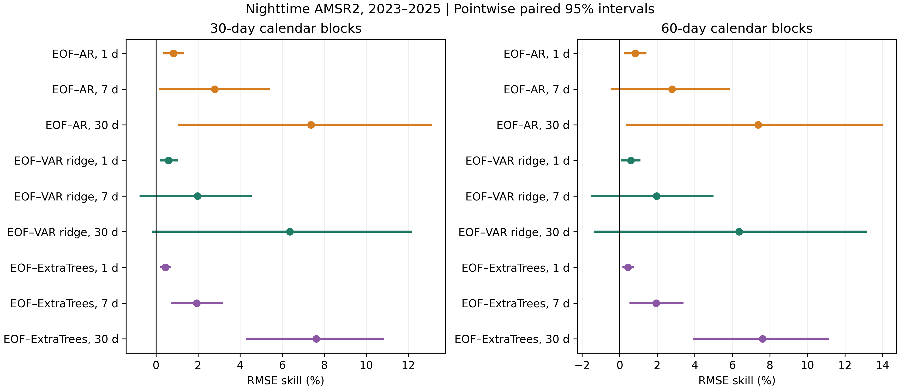
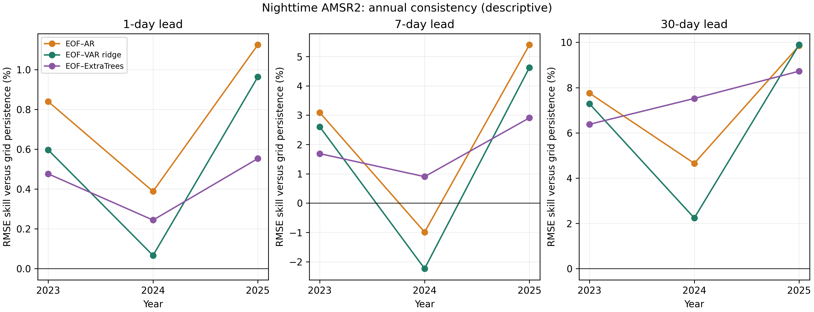

# Locked multi-year instrument extension and stronger spatial controls

## Design and chronology

Forecast and model bytes were locked in the protocol with SHA-256 `cf6a462d4d55ecd80915925cea8bba313680f11402a708d9764bc8715a761502`. The public freeze commit is `6edc533f2cd5f7d0d6f61a0b441f6610cd54ebed`. Estimation uses 2010–2019, selection uses 2020–2021 and new AMSR2 targets cover three complete calendar years (2023–2025). Existing 2026 results are retained as a separate period. The previous OISST and 2026 AMSR2 outcomes were already viewed; this extension is conditional on that exploration. New targets do not establish an untouched OISST experiment.

The established rank-10 spatial basis and seasonal field are retained. Coupled ridge VAR coefficients and direct multi-output ExtraTrees increments are new controls. VAR orders 1/3/7 and penalties 0.0001/0.001/0.01/0.1, and six tree specifications (minimum leaf 5/20/50; feature fraction 0.5/1.0) are compared solely using selection-period seven-day full-grid loss. Each tree uses 200 trees, modal features at origin lags 0/1/6/13, known target calendar harmonics and elapsed time. Horizon-specific targets end within the estimation period. Target increments are standardized on training data alone. No atmospheric drivers or numerical ocean forecasts are included, so these controls cannot establish superiority to the broader forecasting literature.

The primary endpoint is nighttime AMSR2 RMSE on common dates and cells, relative to grid-specific anomaly persistence. Nine comparisons comprise three spatial models and three horizons. Paired calendar-block intervals use 1,999 replicates with 30- and 60-day blocks; centered two-sided tests receive Holm adjustment within the nine-test family separately for each block choice. Intervals are pointwise, not simultaneous; a positive interval can coexist with an adjusted p value exceeding 0.05. Approximate stationary-loss assumptions remain. Annual, seasonal and afternoon tables are descriptive. No post-score model changes or bias adjustments are permitted.

## Primary results

| Model | Lead (d) | RMSE (°C) | Skill (%) | Block (d) | 95% skill interval (%) | Holm p (9 tests) |
| --- | --- | --- | --- | --- | --- | --- |
| EOF–AR | 1 | 1.6467 | 0.83 | 30 | [0.40, 1.29] | 0.0105 |
| EOF–AR | 1 | 1.6467 | 0.83 | 60 | [0.29, 1.38] | 0.0385 |
| EOF–ExtraTrees | 1 | 1.6531 | 0.44 | 30 | [0.25, 0.64] | 0.0090 |
| EOF–ExtraTrees | 1 | 1.6531 | 0.44 | 60 | [0.21, 0.69] | 0.0200 |
| EOF–VAR ridge | 1 | 1.6505 | 0.60 | 30 | [0.23, 0.98] | 0.0150 |
| EOF–VAR ridge | 1 | 1.6505 | 0.60 | 60 | [0.13, 1.06] | 0.0975 |
| EOF–AR | 7 | 1.7590 | 2.79 | 30 | [0.19, 5.37] | 0.1410 |
| EOF–AR | 7 | 1.7590 | 2.79 | 60 | [-0.42, 5.81] | 0.3075 |
| EOF–ExtraTrees | 7 | 1.7745 | 1.94 | 30 | [0.79, 3.13] | 0.0120 |
| EOF–ExtraTrees | 7 | 1.7745 | 1.94 | 60 | [0.58, 3.34] | 0.0870 |
| EOF–VAR ridge | 7 | 1.7738 | 1.97 | 30 | [-0.73, 4.50] | 0.1580 |
| EOF–VAR ridge | 7 | 1.7738 | 1.97 | 60 | [-1.48, 4.94] | 0.3075 |
| EOF–AR | 30 | 1.9437 | 7.37 | 30 | [1.09, 13.08] | 0.1200 |
| EOF–AR | 30 | 1.9437 | 7.37 | 60 | [0.40, 13.99] | 0.2200 |
| EOF–ExtraTrees | 30 | 1.9387 | 7.62 | 30 | [4.33, 10.79] | 0.0090 |
| EOF–ExtraTrees | 30 | 1.9387 | 7.62 | 60 | [3.96, 11.10] | 0.0180 |
| EOF–VAR ridge | 30 | 1.9649 | 6.37 | 30 | [-0.14, 12.13] | 0.1410 |
| EOF–VAR ridge | 30 | 1.9649 | 6.37 | 60 | [-1.32, 13.13] | 0.3075 |

## Annual consistency

| year | Model | horizon_days | n_days | RMSE (°C) | Skill (%) |
| --- | --- | --- | --- | --- | --- |
| 2023 | EOF–AR | 1 | 334 | 1.6292 | 0.84 |
| 2023 | EOF–ExtraTrees | 1 | 334 | 1.6351 | 0.48 |
| 2023 | EOF–VAR ridge | 1 | 334 | 1.6331 | 0.60 |
| 2023 | EOF–AR | 7 | 334 | 1.7286 | 3.09 |
| 2023 | EOF–ExtraTrees | 7 | 334 | 1.7536 | 1.69 |
| 2023 | EOF–VAR ridge | 7 | 334 | 1.7373 | 2.60 |
| 2023 | EOF–AR | 30 | 334 | 1.7993 | 7.76 |
| 2023 | EOF–ExtraTrees | 30 | 334 | 1.8262 | 6.38 |
| 2023 | EOF–VAR ridge | 30 | 334 | 1.8085 | 7.29 |
| 2024 | EOF–AR | 1 | 335 | 1.5000 | 0.39 |
| 2024 | EOF–ExtraTrees | 1 | 335 | 1.5022 | 0.24 |
| 2024 | EOF–VAR ridge | 1 | 335 | 1.5048 | 0.07 |
| 2024 | EOF–AR | 7 | 335 | 1.6889 | -0.99 |
| 2024 | EOF–ExtraTrees | 7 | 335 | 1.6573 | 0.90 |
| 2024 | EOF–VAR ridge | 7 | 335 | 1.7097 | -2.23 |
| 2024 | EOF–AR | 30 | 335 | 2.0624 | 4.65 |
| 2024 | EOF–ExtraTrees | 30 | 335 | 2.0003 | 7.52 |
| 2024 | EOF–VAR ridge | 30 | 335 | 2.1147 | 2.24 |
| 2025 | EOF–AR | 1 | 333 | 1.7981 | 1.12 |
| 2025 | EOF–ExtraTrees | 1 | 333 | 1.8085 | 0.55 |
| 2025 | EOF–VAR ridge | 1 | 333 | 1.8010 | 0.96 |
| 2025 | EOF–AR | 7 | 333 | 1.8556 | 5.40 |
| 2025 | EOF–ExtraTrees | 7 | 333 | 1.9045 | 2.91 |
| 2025 | EOF–VAR ridge | 7 | 333 | 1.8708 | 4.63 |
| 2025 | EOF–AR | 30 | 333 | 1.9601 | 9.85 |
| 2025 | EOF–ExtraTrees | 30 | 333 | 1.9846 | 8.73 |
| 2025 | EOF–VAR ridge | 30 | 333 | 1.9592 | 9.89 |

## Interpretation and reproducibility

Positive relative skill indicates lower RMSE against the sampled instrument; it does not identify true SST. RSS calibration uses reference SST information. Microwave quality screening samples only part of the fixed domain, and UTC-date matching does not match observation time or footprint. Report the matched OISST and AMSR2 errors together when interpreting model ranking. The exact loss decomposition is checked on every scored date, and the original 2026 frozen forecast scores are replicated within the documented floating-point tolerance.

The CSV files preserve all daily paired losses, annual and seasonal scores, sampling coverage, source provenance, model selections and adjusted inference. The forecasts and model serialization are protected by the pre-acquisition hashes. The findings strengthen the evidence base but do not by themselves establish a physical mechanism, regional generalization, statistically independent latent truth or suitability for a specific journal tier.
