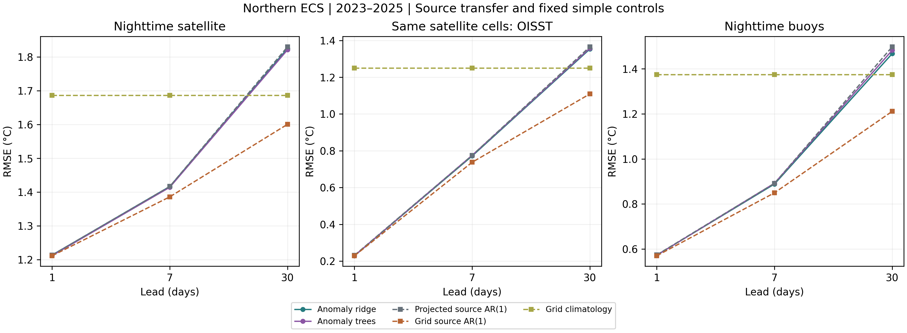
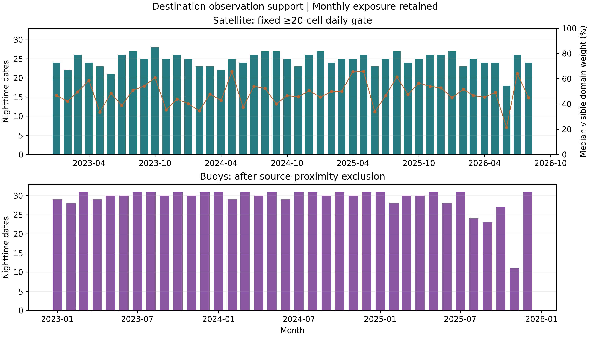

# Destination observation-source verification

## Evidence chronology and methods

Destination verification was publicly locked before scoring its instrument observations (commit 0d9d318, 21 October 2026). The rectangular AMSR2 and iQuam files had already been acquired during earlier stages; source-region instrument results and destination OISST outcomes were known. The lock therefore fixes a conditional geographical extension, with forecast-array fingerprints, source versions and scoring rules, rather than a new pre-acquisition or blind holdout. Thirteen methods at all three leads cover the same 230 destination cells. Existing SST-only regional predictions are projected using origin OISST cell offsets. Additional grid references fit each cell's three-harmonic cycle and linear trend on 2010–2019 only. Grid source AR(1) predicts C_j(t+h) + phi_s^h [T_j(t) − C_j(t)], using the already fixed source-region decay coefficient; grid local AR(1) substitutes the destination regional coefficient. Grid climatology and grid anomaly persistence supply the remaining fixed references. No model or baseline is reselected.

Satellite dates require at least twenty valid cells and common cosine-latitude weights. Each primary year requires 120 nighttime dates. The primary family contains eighteen comparisons: two anomaly models × three leads × three baselines (projected source AR(1), grid source AR(1), grid climatology), with Holm adjustment separately for 30/60-day blocks and 1,999 resamples. Buoys retain the version-fixed quality-five thermometric records and equal platform-day/date weighting, adding exclusion of every record within 20 km of any source-domain cell. The remaining records match a destination cell within 20 km on the same UTC date. Each year requires sixty nighttime buoy dates; buoy, afternoon, matched OISST and January–August 2026 outcomes are descriptive. Both coverage thresholds were fixed before scoring.

## Results

Destination nighttime AMSR2 supplied 896 scored dates and 113,190 cell–date pairs over 2023–2025, with 297, 296 and 303 dates per year and median visible domain weight 59.1%. The coverage gate passed. At thirty days, anomaly ridge/tree RMSE was 1.8252/1.8213°C, compared with 1.6006°C for grid source AR(1) (Table 9). Across the locked eighteen-comparison family, 0 of six anomaly-model/lead cases retained a positive advantage over projected source AR(1) with adjusted p < 0.05 under both block choices. Both models instead had greater error than grid source AR(1) at seven and thirty days (4 of four contrasts; adjusted p = 0.009 under both block choices). One-day gains over climatology survived both choices, whereas seven-day gains over climatology did not survive the sixty-day adjustment. These findings limit the transfer claim to the chosen representation and comparator; they do not support a general complexity advantage.

Buoy verification retained 1,051 nighttime dates, 43,889 records and 29 platform-type/identifier combinations after the source-proximity exclusion. All three annual coverage gates passed. Thirty-day RMSE was 1.4678/1.4827°C for anomaly ridge/trees and 1.2113°C for grid source AR(1), a descriptive ranking consistent with the satellite comparison. The partial 2026 satellite sample, both afternoon/matched-analysis targets and all thirteen methods are retained in the supporting tables. The destination observations extend instrument verification beyond the source region, while shared reference processing, possible in situ assimilation overlap and the adjacent subregion still constrain independence and scope.

## Primary nighttime comparisons

| Model | Lead (d) | Model RMSE | Projected AR(1) | Grid AR(1) | Grid climate |
| --- | --- | --- | --- | --- | --- |
| Anomaly ridge | 1 | 1.2132 | 1.2135 | 1.2111 | 1.6863 |
| Anomaly ridge | 7 | 1.4163 | 1.4166 | 1.3858 | 1.6863 |
| Anomaly ridge | 30 | 1.8252 | 1.8302 | 1.6006 | 1.6863 |
| Anomaly trees | 1 | 1.2118 | 1.2135 | 1.2111 | 1.6863 |
| Anomaly trees | 7 | 1.4142 | 1.4166 | 1.3858 | 1.6863 |
| Anomaly trees | 30 | 1.8213 | 1.8302 | 1.6006 | 1.6863 |

## All eighteen primary contrasts

| Model | Reference | Lead (d) | Gain (%) | 60-d pointwise CI (%) | Holm p, 30 d | Holm p, 60 d |
| --- | --- | --- | --- | --- | --- | --- |
| Anomaly ridge | Grid climatology | 1 | 28.05 | [17.10, 38.77] | 0.0090 | 0.0090 |
| Anomaly ridge | Grid climatology | 7 | 16.01 | [6.23, 25.60] | 0.0385 | 0.0880 |
| Anomaly ridge | Grid climatology | 30 | -8.24 | [-17.81, 1.10] | 0.3400 | 0.5400 |
| Anomaly ridge | Grid source AR(1) | 1 | -0.17 | [-0.36, 0.00] | 0.3570 | 0.5400 |
| Anomaly ridge | Grid source AR(1) | 7 | -2.20 | [-3.32, -1.33] | 0.0090 | 0.0090 |
| Anomaly ridge | Grid source AR(1) | 30 | -14.03 | [-20.02, -8.51] | 0.0090 | 0.0090 |
| Anomaly ridge | Projected source AR(1) | 1 | 0.02 | [-0.05, 0.12] | 1.0000 | 1.0000 |
| Anomaly ridge | Projected source AR(1) | 7 | 0.02 | [-0.17, 0.24] | 1.0000 | 1.0000 |
| Anomaly ridge | Projected source AR(1) | 30 | 0.27 | [-1.74, 2.35] | 1.0000 | 1.0000 |
| Anomaly trees | Grid climatology | 1 | 28.14 | [17.28, 38.80] | 0.0090 | 0.0090 |
| Anomaly trees | Grid climatology | 7 | 16.14 | [6.77, 25.19] | 0.0240 | 0.0720 |
| Anomaly trees | Grid climatology | 30 | -8.01 | [-16.33, 0.08] | 0.2025 | 0.4005 |
| Anomaly trees | Grid source AR(1) | 1 | -0.05 | [-0.25, 0.12] | 1.0000 | 1.0000 |
| Anomaly trees | Grid source AR(1) | 7 | -2.05 | [-3.17, -1.13] | 0.0090 | 0.0090 |
| Anomaly trees | Grid source AR(1) | 30 | -13.79 | [-19.52, -8.89] | 0.0090 | 0.0090 |
| Anomaly trees | Projected source AR(1) | 1 | 0.14 | [0.04, 0.25] | 0.0800 | 0.1500 |
| Anomaly trees | Projected source AR(1) | 7 | 0.18 | [-0.41, 0.62] | 1.0000 | 1.0000 |
| Anomaly trees | Projected source AR(1) | 30 | 0.49 | [-0.70, 1.69] | 1.0000 | 1.0000 |

## All nighttime buoy methods

| Method | 1 d RMSE | 7 d RMSE | 30 d RMSE |
| --- | --- | --- | --- |
| raw ridge | 0.5677 | 1.2248 | 2.5494 |
| raw trees | 0.5740 | 0.9340 | 1.8470 |
| Anomaly ridge | 0.5725 | 0.8884 | 1.4678 |
| Anomaly trees | 0.5717 | 0.8918 | 1.4827 |
| projected climatology | 1.0820 | 1.2043 | 1.5878 |
| projected local ar1 | 0.5737 | 0.8997 | 1.5217 |
| Projected source AR(1) | 0.5734 | 0.8915 | 1.4983 |
| projected anomaly persistence | 0.5737 | 0.8971 | 1.4951 |
| raw persistence | 0.5998 | 1.1745 | 3.2026 |
| Grid climatology | 1.3750 | 1.3750 | 1.3750 |
| Grid source AR(1) | 0.5695 | 0.8493 | 1.2113 |
| Grid local AR(1) | 0.5702 | 0.8634 | 1.2518 |
| Grid anomaly persistence | 0.5700 | 0.8652 | 1.2922 |

