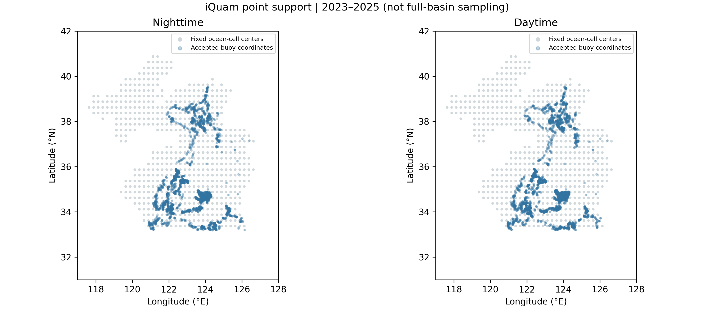

# Three-year in situ buoy verification

The iQuam source versions, forecast bytes and matching rules were frozen before these SST point values were acquired. The source covers all 36 months of 2023–2025. Best-quality (`quality_level=5`) thermometric records from drifting, moored, high-resolution drifter and CRW buoys are matched to their nearest fixed ocean-cell center within 20 km on the same UTC date. Nighttime uses the provider's day/night flag; daytime is a separate descriptive sensitivity. Kelvin values are converted to degrees Celsius without bias adjustment. Neither observation time, instrument depth nor footprint is identical to a daily gridded analysis.

Repeated records first receive equal weight within a platform-day; platforms then receive equal weight within each date, and scoring dates receive equal weight. Squared errors are averaged before their square root. Consequently, many hourly records from one buoy cannot dominate a day or masquerade as many independent platforms. This sample is not area weighted and cannot be interpreted as a basin mean.

The frozen gate requires 60 nighttime scoring dates in each year: **passed**. Results are descriptive; no additional significance test, forecast selection or tuning was undertaken.

| Model | Lead (d) | Dates | RMSE (°C) | Bias (°C) | Skill (%) |
| --- | --- | --- | --- | --- | --- |
| EOF–AR | 1 | 1036 | 0.7634 | -0.1467 | 1.82 |
| EOF–ExtraTrees | 1 | 1036 | 0.7713 | -0.1260 | 0.79 |
| EOF–VAR ridge | 1 | 1036 | 0.7723 | -0.1658 | 0.68 |
| Regional persistence projection | 1 | 1036 | 0.7791 | -0.1056 | -0.20 |
| Regional projection | 1 | 1036 | 0.7655 | -0.1048 | 1.55 |
| Grid anomaly persistence | 1 | 1036 | 0.7775 | -0.1056 | 0.00 |
| Raw grid persistence | 1 | 1036 | 0.8110 | -0.1125 | -4.31 |
| EOF–AR | 7 | 1036 | 1.0431 | -0.3415 | 1.23 |
| EOF–ExtraTrees | 7 | 1036 | 1.0156 | -0.2315 | 3.83 |
| EOF–VAR ridge | 7 | 1036 | 1.0962 | -0.4437 | -3.81 |
| Regional persistence projection | 7 | 1036 | 1.0537 | -0.1172 | 0.22 |
| Regional projection | 7 | 1036 | 1.0284 | -0.1128 | 2.62 |
| Grid anomaly persistence | 7 | 1036 | 1.0560 | -0.1175 | 0.00 |
| Raw grid persistence | 7 | 1036 | 1.4526 | -0.1652 | -37.55 |
| EOF–AR | 30 | 1036 | 1.4303 | -0.6217 | 2.67 |
| EOF–ExtraTrees | 30 | 1036 | 1.2917 | -0.3439 | 12.11 |
| EOF–VAR ridge | 30 | 1036 | 1.5102 | -0.7522 | -2.76 |
| Regional persistence projection | 30 | 1036 | 1.5324 | -0.1676 | -4.27 |
| Regional projection | 30 | 1036 | 1.4551 | -0.1162 | 0.99 |
| Grid anomaly persistence | 30 | 1036 | 1.4696 | -0.1576 | 0.00 |
| Raw grid persistence | 30 | 1036 | 4.0416 | -0.3509 | -175.01 |

## Limits of independence

iQuam quality control uses Reynolds and CMC analysis references; some in situ measurements may overlap inputs to OISST. This is a third measurement pathway and a useful point-support check, not a statistically independent held-out sample or error-free truth. Along with AMSR2 calibration dependencies, it prevents interpretation of agreement as three independent estimates of latent ocean temperature. Original data flags, locations, times, identifiers and source checksums are retained; matched-OISST and iQuam loss tables use exactly the same platform/day support.

Source: [NOAA iQuam](https://www.star.nesdis.noaa.gov/socd/sst/iquam/data.html); QC dependency: [Zhang et al. (2021)](https://doi.org/10.1175/JTECH-D-20-0203.1).

The [NOAA provider notice](https://www.star.nesdis.noaa.gov/socd/sst/iquam/) states that SST team members have not monitored the data since 31 May 2025. Later archived files do not establish continuing human review. In this sample, October 2025 has no accepted nighttime buoy records; the supplied monthly coverage table retains that zero. Complete acquisition of 36 source files does not imply complete observational sampling or constant data quality.
