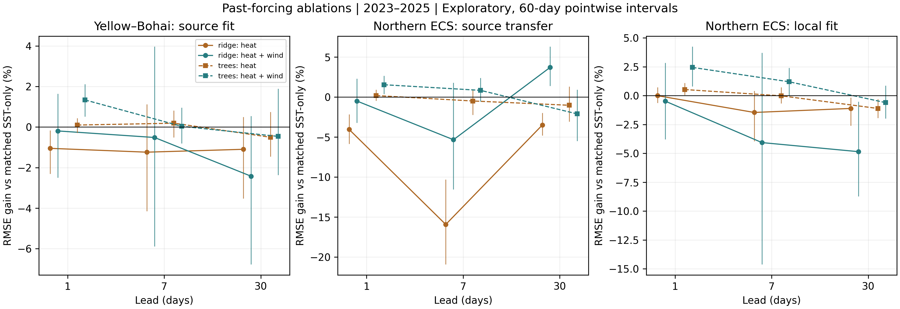

# Past-forcing information and geographical transfer

## Evidence status

Retrospective exploratory design after all original Yellow–Bohai outcomes were viewed. Not a prospective or untouched holdout. Model hyperparameters selected using Yellow–Bohai 2020–2021 seven-day errors only; parameters refitted on 2010–2019 for each horizon. Destination-local references use those same source-selected hyperparameters. Direct transfer copies all source coefficients and scaling without destination fitting. Physical features use reanalysis no later than origin minus one day, a conservative temporal restriction, not a verified operational latency. Daily reanalysis heat fluxes and winds are diagnostic model products, not independent flux observations or proof of causality. Original frozen protocols and results are preserved.

Before reading any forcing-model test results, NOAA PSL metadata was checked on 2026-10-16: NCEP/NCAR R1 production ended 2026-03-17. Restrict the complete-year forcing ablation and associated transfer comparisons to 2023–2025; do not fill or splice the unavailable April–August 2026 forcing. SST-only transfer may additionally report January–August 2026, separately.

Before any new model test scores, limit the evaluated destination to the intersection of Eastern China Sea MRGID 4302 with the already cached original OISST box (31–42 N, 117–128 E). NOAA NCSS returned HTTP 429 and CoastWatch ERDDAP timed out. This is a northern Eastern China Sea subregion, not full-basin validation. The original full destination box remains documented as a deferred acquisition target. The cache domain was selected for data availability, not model skill.

## Results

The forcing ablation uses all 1,096 dates in 2023–2025. Across the twelve Yellow–Bohai family/group/horizon contrasts, 4 have a positive point estimate, with RMSE changes relative to matched SST-only controls ranging from -2.43% to 1.34% (positive denotes improvement). 0 source contrasts retain a positive gain and a Holm-adjusted p value below 0.05 under both block lengths in the full 36-comparison exploratory family. The adjustment does not erase the prior viewing of outcomes; these are conditional exploratory diagnostics, not new confirmatory discoveries.

Transfer is evaluated on 230 fixed ocean cells in the northern Eastern China Sea (cell centres 31.125–33.125°N, 120.875–127.875°E), distinct from the 651 source cells. Source coefficients, feature definitions and scaling are copied unchanged. Destination-local fits use destination 2010–2019 observations but the same source-selected hyperparameters; they are references rather than destination-optimized upper bounds. Table 7 retains both families and all leads, including deterioration relative to destination-local anomaly persistence. January–August 2026 SST-only results are reported separately in the supplement. The subregion is contiguous with the source shelf and does not establish transfer to the full Eastern China Sea or a distant dynamical regime.

After the raw transfer failures were inspected, a further descriptive reference calibrated destination feature and increment location/scale from 2010–2019 alone, retaining source regression/tree coefficients. This uses destination training histories and is distinct from unchanged-scaler transfer. At thirty days in 2023–2025, calibrated SST-only RMSE is 1.0360°C for ridge and 1.0504°C for trees. The large raw-transfer penalty is reduced, but 6 of six calibrated SST-only family/lead point estimates remain worse than local anomaly persistence in these three years. Joint calibration does not identify which distributional component or physical process causes the remaining gap. No new significance test or model selection is attached.

A further descriptive diagnostic projects every source-region forecast onto the origin OISST spatial offsets and evaluates the same 1,002 nighttime AMSR2 dates. Across all twelve forcing-versus-SST-only contrasts, 8 positive point estimates span -0.07% to 1.06%. No additional fitting, selection or significance claim is made. These regional-increment projections are distinct from the previously locked nonlinear spatial model.

## Every SST-only transfer comparison

| Period | Family | Lead (d) | Source RMSE | Transfer RMSE | Local-fit RMSE | Local persistence RMSE | Transfer skill (%) |
| --- | --- | --- | --- | --- | --- | --- | --- |
| 2023-2025 | ridge | 1 | 0.1429 | 0.2084 | 0.1531 | 0.1584 | -31.59 |
| 2023-2025 | ridge | 7 | 0.5506 | 1.0692 | 0.5696 | 0.5924 | -80.47 |
| 2023-2025 | ridge | 30 | 0.8101 | 2.1815 | 0.8481 | 0.9711 | -124.65 |
| 2023-2025 | trees | 1 | 0.1509 | 0.1641 | 0.1609 | 0.1584 | -3.61 |
| 2023-2025 | trees | 7 | 0.5911 | 0.6570 | 0.6075 | 0.5924 | -10.90 |
| 2023-2025 | trees | 30 | 0.9519 | 1.4497 | 1.0829 | 0.9711 | -49.29 |
| 2026-Jan-Aug | ridge | 1 | 0.1361 | 0.2139 | 0.1720 | 0.1820 | -17.49 |
| 2026-Jan-Aug | ridge | 7 | 0.5748 | 1.0200 | 0.6304 | 0.6873 | -48.41 |
| 2026-Jan-Aug | ridge | 30 | 0.7441 | 1.9562 | 0.7541 | 1.1599 | -68.65 |
| 2026-Jan-Aug | trees | 1 | 0.1404 | 0.1822 | 0.1807 | 0.1820 | -0.10 |
| 2026-Jan-Aug | trees | 7 | 0.5744 | 0.6987 | 0.6470 | 0.6873 | -1.66 |
| 2026-Jan-Aug | trees | 30 | 0.7313 | 1.3844 | 0.7899 | 1.1599 | -19.35 |

## Source forcing contrasts

| family | group | horizon_days | Gain (%) | 60-d pointwise CI (%) | Holm p (36) |
| --- | --- | --- | --- | --- | --- |
| ridge | sst_heat | 1 | -1.05 | [-2.29, -0.18] | 0.7560 |
| ridge | sst_heat | 7 | -1.24 | [-4.13, 1.11] | 1.0000 |
| ridge | sst_heat | 30 | -1.10 | [-3.51, 0.47] | 1.0000 |
| ridge | sst_heat_wind | 1 | -0.19 | [-2.48, 1.62] | 1.0000 |
| ridge | sst_heat_wind | 7 | -0.52 | [-5.86, 3.95] | 1.0000 |
| ridge | sst_heat_wind | 30 | -2.43 | [-6.75, 0.52] | 1.0000 |
| trees | sst_heat | 1 | 0.10 | [-0.27, 0.42] | 1.0000 |
| trees | sst_heat | 7 | 0.19 | [-0.49, 0.79] | 1.0000 |
| trees | sst_heat | 30 | -0.50 | [-1.43, 0.72] | 1.0000 |
| trees | sst_heat_wind | 1 | 1.34 | [0.53, 2.09] | 0.1760 |
| trees | sst_heat_wind | 7 | 0.04 | [-0.79, 0.93] | 1.0000 |
| trees | sst_heat_wind | 30 | -0.46 | [-2.35, 1.87] | 1.0000 |

## Post-outcome training-calibrated reference

| Period | Family | Lead (d) | Raw transfer RMSE | Training-calibrated RMSE | Local-fit RMSE | Local persistence RMSE |
| --- | --- | --- | --- | --- | --- | --- |
| 2023-2025 | ridge | 1 | 0.2084 | 0.1738 | 0.1531 | 0.1584 |
| 2023-2025 | ridge | 7 | 1.0692 | 0.6676 | 0.5696 | 0.5924 |
| 2023-2025 | ridge | 30 | 2.1815 | 1.0360 | 0.8481 | 0.9711 |
| 2023-2025 | trees | 1 | 0.1641 | 0.1683 | 0.1609 | 0.1584 |
| 2023-2025 | trees | 7 | 0.6570 | 0.6171 | 0.6075 | 0.5924 |
| 2023-2025 | trees | 30 | 1.4497 | 1.0504 | 1.0829 | 0.9711 |
| 2026-Jan-Aug | ridge | 1 | 0.2139 | 0.1796 | 0.1720 | 0.1820 |
| 2026-Jan-Aug | ridge | 7 | 1.0200 | 0.6735 | 0.6304 | 0.6873 |
| 2026-Jan-Aug | ridge | 30 | 1.9562 | 0.8704 | 0.7541 | 1.1599 |
| 2026-Jan-Aug | trees | 1 | 0.1822 | 0.1849 | 0.1807 | 0.1820 |
| 2026-Jan-Aug | trees | 7 | 0.6987 | 0.6718 | 0.6470 | 0.6873 |
| 2026-Jan-Aug | trees | 30 | 1.3844 | 0.9772 | 0.7899 | 1.1599 |

## Interpretation

These models add lagged, coarse reanalysis information. They do not close a mixed-layer heat budget, separate forcing from feedback, or identify advection, entrainment or causal drivers. The wind magnitude is the magnitude of a daily regional-mean vector, not daily-mean scalar wind speed or wind stress. Reanalysis fluxes depend on prescribed/analysed SST and may include coastal land fractions. The one-day input delay is a calendar cutoff, not a measured operational publication latency. The destination lies on the adjacent shelf; no complete Eastern China Sea or instrument-independent geographical validation is established. Every selected family, horizon, year and season is retained. Raw predictions and serialized models accompany the local reproducibility package.

