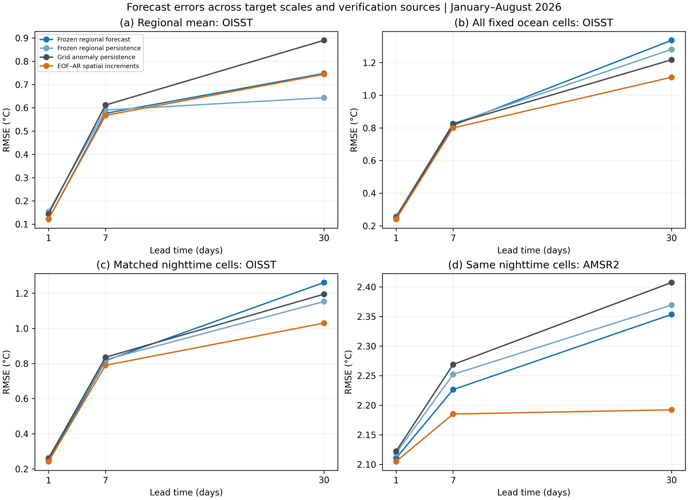
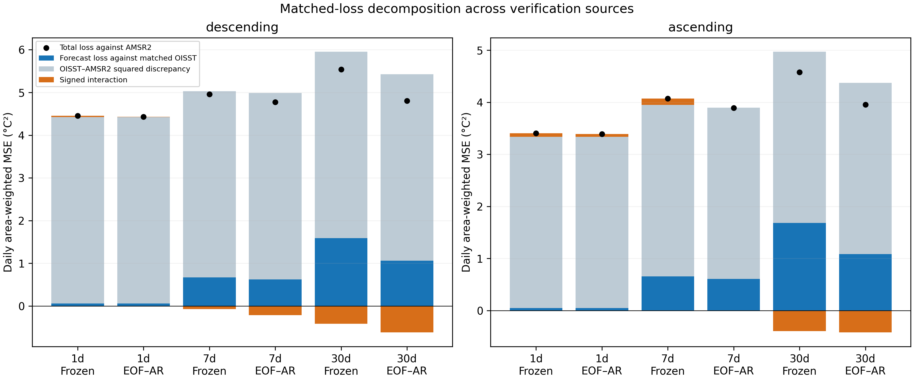
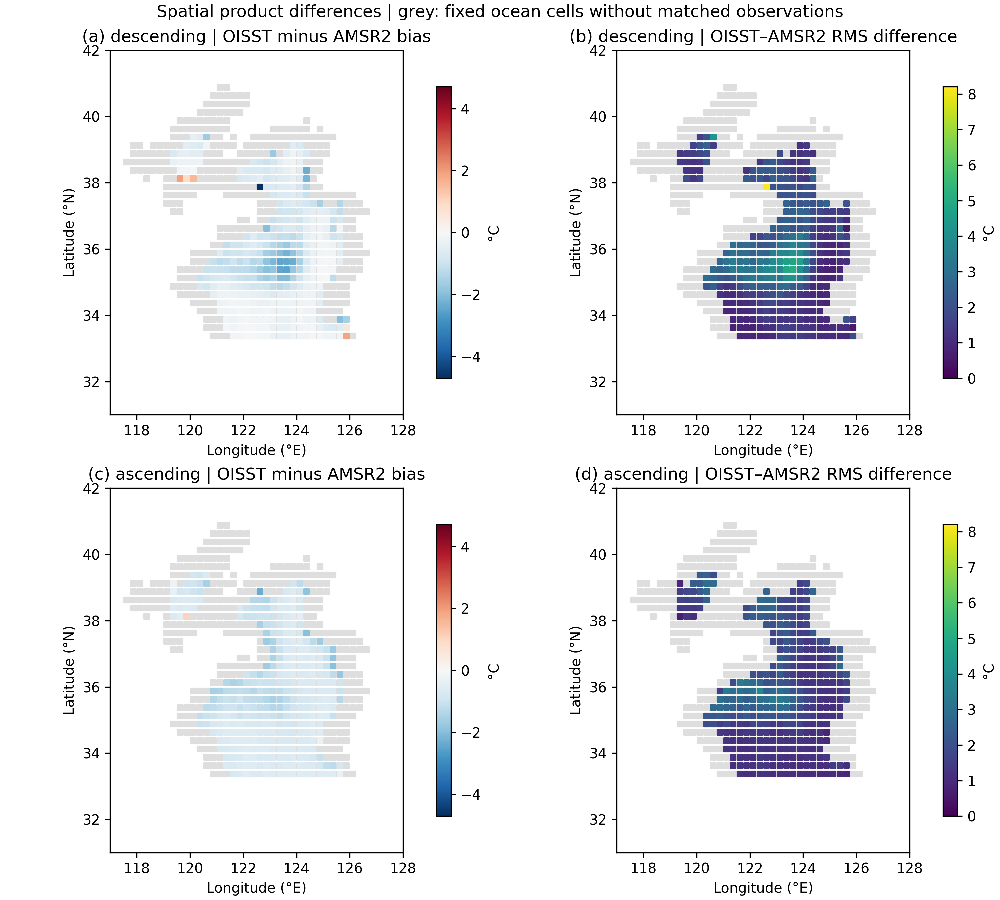
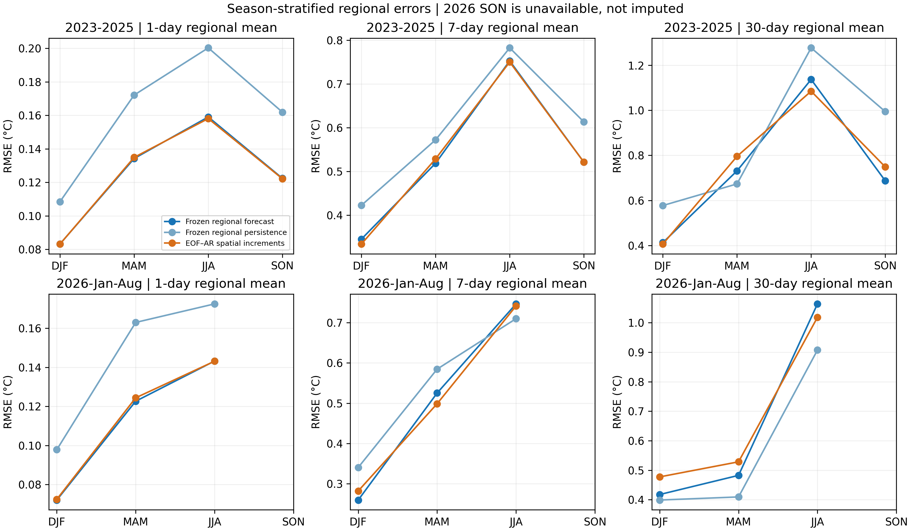
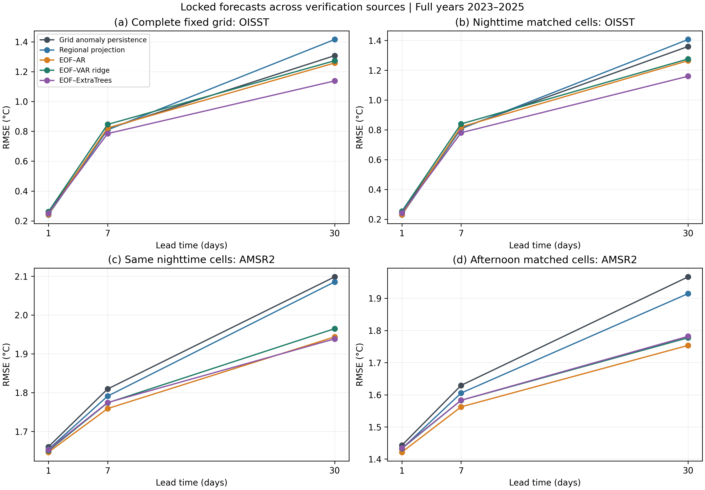
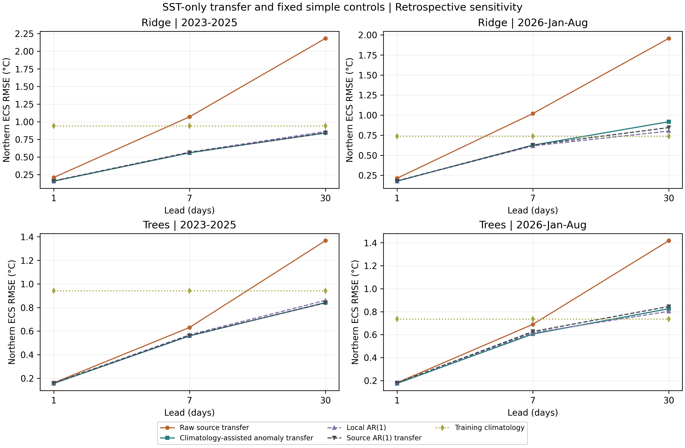

# Spatial aggregation and observation-source dependence of short-range sea surface temperature forecast skill in the Yellow–Bohai Sea

## Abstract

Forecast skill estimated from a regional sea surface temperature (SST) analysis need not transfer to local temperatures measured by another instrument. We examine this transfer in the Yellow–Bohai Sea using daily NOAA OISST from 2010 to August 2026, AMSR2 microwave retrievals and buoy point observations. Seasonal autoregressive and regularized models were estimated, selected and calibrated in separate historical periods, then frozen before acquiring the 2026 OISST targets. Against regional OISST, the selected forecasts reduced one-day root-mean-square error (RMSE) by 21.1% relative to anomaly persistence, whereas seven-day and thirty-day skill was 2.4% and −16.2%. Matched nighttime AMSR2 verification during January–August 2026 yielded corresponding improvements of only 0.38%, 1.14% and 0.67%; all original thirty-day-block intervals included zero. Exact matched-loss identities show that changing verification source can reverse squared-loss advantage on identical dates and cells. A subsequent forecast-locked extension to all three years 2023–2025 reduces thirty-day nighttime AMSR2 RMSE by 7.6% using a nonlinear spatial control; the nine-comparison Holm test supports the gain with both 30- and 60-day blocks. A descriptive buoy comparison covers 1,036 nighttime dates with platform-balanced daily losses. An exploratory past-flux/wind ablation yields no multiplicity-supported source-region gain, and unchanged-parameter transfer degrades on an adjacent northern Eastern China Sea subregion. A later pre-scoring-locked northern Eastern China Sea check found larger thirty-day errors for regional anomaly-transfer models than for a fixed grid anomaly-decay reference on both AMSR2 and buoy observations. Shared calibration, quality-control references and possible assimilation overlap limit independence. These diagnostics distinguish aggregation, incomplete sampling, model representation and verification-source effects without assigning any product error-free truth or identifying a physical mechanism.

**Keywords:** sea surface temperature; Yellow Sea; Bohai Sea; autoregression; forecast verification; microwave remote sensing; observational discrepancy

## 1. Introduction

The evaluation of a sea surface temperature forecast depends on the spatial support, sampling time and measurement characteristics of its target. An area mean, a gridded analysis and a satellite retrieval represent different quantities, even on the same nominal grid. In shallow shelf seas, averaging can suppress local variability, while microwave quality screening limits the coastal observations available for comparison. A forecast that performs well for the regional mean of its training product may therefore offer little improvement at locations sampled by another instrument.

SST forecasts use statistical, machine-learning and dynamical approaches. Wolff et al. (2020) evaluated statistical and machine-learning models with atmospheric information, and Jacox et al. (2022) studied seasonal marine-heatwave forecasts. The interpretation of forecast accuracy also depends on the verification target: SST intercomparisons are sensitive to reference selection, quality control and spatial representation (Huang et al., 2023). Comparing forecasts across observation sources can therefore reveal whether an apparent improvement extends beyond one target.

The Yellow Sea also offers a setting in which to distinguish daily statistical persistence from ocean memory. Using observations and numerical experiments, Liu et al. (2026) identified winter-to-winter SST anomaly reemergence in the central Yellow Sea and linked it to subsurface storage and seasonal mixed-layer changes. Daily surface autocorrelation alone cannot establish that mechanism. We use lagged surface associations to describe the forecasting environment without attributing an autoregressive coefficient to a heat-budget process.

NOAA OISST supplies a spatially complete analysis for consistent historical modelling (Banzon et al., 2016; Huang et al., 2021). AMSR2 supplies a separate microwave measurement pathway, but matching these sources does not create an error-free SST standard. Infrared and microwave products can have condition-dependent differences (Castro et al., 2008; Gentemann, 2014). Moreover, RSS AMSR2 version 8.2 uses reference SST information in drift calibration (Wentz, 2021). Independence of the measurement instrument must consequently be distinguished from independence of all processing and reference information.

This study asks three linked questions. First, does a historical statistical model retain its improvement over anomaly persistence in a later, frozen temporal evaluation? Second, how does the observed improvement change between an area mean and matched local grid cells? Third, how do contemporaneous differences between analysis and retrieval affect absolute forecast loss and relative model advantage? We address these questions using common forecasts, common scoring support and exact loss accounting in an auditable regional analysis. The model families and algebraic identities are established methods; we do not claim a new forecasting algorithm or a general solution to observational error identification.

## 2. Data and experimental design

### 2.1 Study domain and OISST record

The study domain follows the Marine Regions IHO sea-area polygon MRGID 4303 (Flanders Marine Institute, 2018). Because this polygon includes the Bohai Sea, we refer to the domain as the Yellow–Bohai Sea. OISST subsets span 31–42°N and 117–128°E at 0.25° resolution. The fixed mask contains 651 polygon-selected ocean cells present on 1 January 2010. Earlier exploratory analyses using a rectangular domain and an interior polygon subset remain in the repository.

The daily record extends from 1 January 2010 to 31 August 2026, with 6,087 dates and no gaps in the fixed ocean-cell cube. Regional means use cosine-latitude weights and an 80% valid-weight requirement. The analysis is based on 200 monthly NOAA subsets, including 192 for 2010–2025 and eight for 2026. Acquisition URLs and SHA-256 checksums are preserved. This is an SST analysis, not a set of direct observations at every cell. Changes in the operational input streams also preclude treating the entire record as an invariant observing system; the NOAA product documentation provides the applicable history.

### 2.2 Separation of estimation, selection and evaluation

The historical exploration compared seasonal, persistence, autoregressive and regularized models across separate evaluation periods. For the frozen specification, coefficients were estimated on 2010–2019, models were selected on 2020–2021, and intervals were calibrated on 2022. The 2023–2025 historical scores were available before the 2026 temporal exercise. Selected methods, coefficients, seasonal templates and interval radii were recorded in a versioned protocol before the 2026 target files were acquired; none were refitted, reselected or recalibrated on those targets.

Forecasts have lead times of 1, 7 and 30 days. A forecast valid on date d uses observations no later than origin d−h. Previous observed days become available as origins advance, as in a rolling forecasting exercise, but observations between an individual origin and its target are excluded. Selection across candidate orders and ridge penalties used seven-day RMSE. The frozen one-day method is a ridge model with seasonal harmonics and a trend; the seven-day and thirty-day methods use a seasonal-trend autoregressive model. Exact parameters and the original comparison inventory are supplied as machine-readable files.

This design tests later-date transfer of a frozen analysis-based forecast, conditional on the earlier historical exploration. It is not a fully operational issue-time experiment: the retrospective OISST archive may contain revisions, and no end-to-end acquisition latency was simulated. The 2026 interval ends in August and therefore does not represent a complete annual cycle.

### 2.3 Independent-instrument verification

External verification uses the RSS GCOM-W1 AMSR2 daily environmental suite, version 8.2 (Wentz et al., 2021). All 243 daily source files for January–August 2026 were acquired. The ascending and descending passes are analysed separately; they correspond approximately to afternoon and nighttime local sampling. Native 0.25° cell centres coincide with the acquired OISST centres, allowing matching without spatial interpolation. Matching by UTC date does not make an OISST daily analysis and a satellite pass simultaneous measurements. The microwave footprint also exceeds the nominal grid spacing.

The external protocol was frozen before the AMSR2 target values were read, but after the OISST 2026 outcomes had been inspected. No interpolation, bias adjustment, coverage threshold modification or model recalibration was performed in response to the AMSR2 results. A valid cell must belong to the fixed ocean mask, have finite SST within −3 to 35°C and a valid UTC hour in [0,24), and have zero land, coast, sea-ice and no-observation flags. A date requires at least 20 matched cells, with a minimum of 120 scoring dates per pass and horizon.

The resulting support consists of 225 nighttime dates with 46,393 cell–date pairs and 215 afternoon dates with 49,079 pairs. Median valid fractions of the fixed domain weight are 34.4% and 35.4%, respectively. These are quality-screened, predominantly offshore samples. They cannot be interpreted as full-basin external mean temperatures or as coastal validation. Day-specific weights are normalized over the available common cells; dates then receive equal weight in the final loss. Satellite cells are not treated as independent statistical replicates.

RSS processing uses Reynolds SST information for drift calibration. The current NOAA OISST input documentation lists infrared satellite and in situ inputs rather than AMSR2, but shared reference information remains possible. We therefore use the term independent-instrument verification and do not assert full statistical independence. A complete official file for 5 February 2026 was independently decoded using the NetCDF interface; SST, measurement times and all four masks matched the range-read subsets exactly. This check addresses decoding integrity, not the geophysical accuracy of either product.

### 2.4 Locked three-year extension and in situ point verification

To extend beyond the partial 2026 annual cycle, we fixed seven spatial forecast series, including two stronger controls, before acquiring AMSR2 observations for all 1,096 dates of 2023–2025. Their forecast-array hash, fitted-model hashes and comparison family were publicly committed on 10 October 2026. Acquisition completed on 15 October, without changing model parameters, thresholds or bias corrections. Previous OISST outcomes and 2026 AMSR2 outcomes had already been viewed. This is therefore a pre-acquisition external-source extension conditional on prior exploration; it does not create an untouched OISST test. The original 2026 frozen comparisons remain a separate evidence stage.

The same instrument version, fixed mask and quality criteria are retained. The new primary sample has 1002 nighttime dates and 209,210 cell–date pairs, with 334, 335, 333 dates in 2023, 2024 and 2025, respectively. Median nighttime valid domain weight is 35.2%. Afternoon scores and seasonal strata are descriptive sensitivities. Missing source files, failed transfers and valid-but-insufficient daily support are tracked separately; source acquisition completeness does not imply complete geophysical sampling.

A separate protocol fixed all 36 monthly iQuam version-2.10 file URLs and point-matching rules before reading these in situ SST targets (NOAA/NESDIS/STAR, 2026). Best-quality (`quality_level=5`) thermometric drifting, moored, high-resolution drifter and CRW buoy records are matched to the nearest fixed ocean-cell centre within 20 km on the same UTC date. Nighttime and daytime follow the provider's flag. Kelvin values are converted to Celsius without adjustment. Losses are first averaged within platform type, identifier and UTC date, then equally across platforms within a date, and finally equally across dates. Thus hourly sampling density does not weight the comparison, and temperatures are not averaged before squared loss. A frozen minimum of 60 nighttime dates in each year defines coverage eligibility; point-support results remain descriptive.

iQuam is a third measurement pathway with important dependencies: its quality control uses analysis references, including Reynolds and CMC SST (Zhang et al., 2021), and buoy measurements may overlap OISST inputs. The point observations differ in depth, timing and spatial support from a daily grid. NOAA's [provider notice](https://www.star.nesdis.noaa.gov/socd/sst/iquam/) states that SST team members have not monitored the data since 31 May 2025. Availability of later monthly files therefore does not establish continuing human review or an unchanged observing system. We retain the frozen automated quality threshold and report actual coverage, including months without accepted buoy records. We do not treat iQuam as statistically independent held-out truth or infer individual product error variances from these sources.

### 2.5 Exploratory forcing and adjacent-sea extension

A subsequent retrospective extension adds NOAA PSL NCEP/NCAR Reanalysis 1 daily surface fields for 2010–2025 (Kalnay et al., 1996): downward/upward shortwave and longwave radiation, latent/sensible heat flux and 10-m zonal/meridional wind. Annual files are retrieved from the official public file service, cropped to 22–44°N and 115–135°E, and verified for source identity, units, daily completeness and response/subset checksums. These fields use the 192 × 94 Gaussian grid, approximately 1.9° spacing, rather than the SST grid. Each fixed SST ocean centre is assigned its spherical nearest Gaussian centre, retaining the SST cosine-latitude weights. This is a coarse coastal forcing proxy; no land-fraction correction is available.

The destination is the intersection of Marine Regions Eastern China Sea MRGID 4302 with the original cached SST box. Its 230 first-day ocean cells have centres spanning 31.125–33.125°N and 120.875–127.875°E and do not overlap the 651 source cells. This northern subregion was fixed for cache availability before new model scores; no basin-wide destination SST acquisition is used. It is neither the complete Eastern China Sea nor a geographically distant test. NOAA reports that Reanalysis 1 production ended on 17 March 2026; forcing comparisons therefore use the complete 2023–2025 years. SST-only transfer additionally reports January–August 2026. No missing forcing is filled or spliced to another product. The design and availability amendments are recorded locally, without a claim of a public prospective freeze.

## 3. Methods

### 3.1 Regional forecasts and their spatial projection

Let R(d) denote the locked regional OISST mean and r̂(d|o) its forecast from origin o=d−h. Let Oᵢ(o) denote the OISST value at grid cell i on that origin. The frozen regional forecast is evaluated locally through

**Fᵢ(d|o) = Oᵢ(o) + r̂(d|o) − R(o).**  (1)

The rule preserves the origin spatial field and applies the same predicted regional increment at every cell. It is a zero-fit projection, not a fitted local forecast. The frozen anomaly-persistence baseline uses the same rule with its own regional forecast. Raw grid persistence supplies an additional reference. Thus the external comparison tests whether an estimated regional increment improves the persisted origin field on the sampled cells, rather than whether a purely regional model reproduces local spatial evolution.

### 3.2 Retrospective spatial control

After viewing the original OISST and AMSR2 results, we designed an initial spatial extension to examine the adequacy of that projection. This initial analysis is explicitly retrospective. It is computationally separated from the original frozen results: it estimates coefficients, seasonal fields and spatial modes only on 2010–2019, selects candidates only on 2020–2021, and evaluates them on 2023–2025 and January–August 2026. This restriction prevents future values from entering fitted parameters; it does not make the initial evaluation an untouched confirmatory test. Its specification was subsequently retained for the forecast-locked three-year external extension described below.

For each cell, three annual harmonics represent the seasonal cycle, with and without a linear trend. Cosine-latitude weighting is applied before estimating empirical orthogonal functions (EOFs), following standard spatial decomposition principles (Hannachi et al., 2007). Candidate ranks are 1, 3, 5 and 10; autoregressive orders are 1, 3 and 7. Candidates with unstable retained-mode autoregressions are excluded. The retained anomalies are propagated autoregressively, while unresolved origin anomalies persist. Specifically, with seasonal field C(d), origin anomaly a(o), retained weighted EOF reconstruction operator B and modal scores z,

**Fᴱᴼᶠ(d|o) = C(d) + a(o) + B[ẑ(d|o) − z(o)].**  (2)

The same candidate grid and seven-day area-weighted grid loss determine one spatial specification for all horizons. The selected control has rank 10, order 7 and trend inclusion true, captures 84.5% of training anomaly variance, and has selection-period seven-day RMSE of 0.8351°C. A grid-specific seasonal anomaly-persistence baseline uses the no-trend seasonal field estimated on the same training period. The spatial control is intended to diagnose target-scale effects and omitted spatial evolution, rather than to establish superiority over dynamical or multivariate machine learning forecasts.

### 3.3 Common-support errors and exact loss accounting

RMSE is the square root of the mean daily weighted squared error. We report skill as 1−RMSE(model)/RMSE(baseline), with positive values indicating improvement. Each comparison uses identical dates, masks and weights. Evaluations are separated into the complete regional mean, the complete fixed grid, OISST on AMSR2-matched cells, and AMSR2 on those same cells. Comparing the latter two holds sampling support fixed while changing the verification source. Comparing a full-grid mean squared error with a regional-mean squared error illustrates the effect of aggregation, although their skill ratios additionally depend on baseline performance.

For a matched cell and date, define eᵢ=Fᵢ−Oᵢ and δᵢ=Oᵢ−Aᵢ, where A denotes AMSR2. With normalized weights wᵢ, the exact identity is

**Lᴬ(F) = Σwᵢeᵢ² + Σwᵢδᵢ² + 2Σwᵢeᵢδᵢ.**  (3)

The terms describe forecast loss against matched OISST, squared product discrepancy and a signed interaction. The discrepancy is not an estimate of AMSR2 measurement error or an external error floor. The interaction can cancel or amplify the positive discrepancy term. A second decomposition writes each day's external MSE as its squared weighted mean error plus weighted spatial error variance. These identities require no independence assumptions and are checked numerically for every scored date.

For baseline forecast Fᵇ and model forecast Fᵐ, define Dᴼ=Lᴼ(Fᵇ)−Lᴼ(Fᵐ), with Dᴬ defined analogously. Then

**Dᴬ − Dᴼ = 2Σwᵢ(Fᵇᵢ−Fᵐᵢ)δᵢ.**  (4)

Equation (4) shows that the magnitude of product discrepancy alone does not determine model ranking. Its alignment with the difference between forecasts controls the change in squared-loss advantage. We use frozen regional anomaly persistence as the reference for this accounting, and report grid-specific persistence separately for the spatial-model comparison. Neither identity identifies latent true SST from two imperfect products.

### 3.4 Uncertainty, interval scores and stratified diagnostics

The original inference resamples paired daily losses with calendar blocks, retaining common support and gaps. Original confidence intervals use 1,000 replicates and 30- and 60-day block lengths. Because forecasts overlap and SST errors are persistent, neither dates nor cell–date pairs are assumed independent. Block methods follow dependence-aware resampling principles (Künsch, 1989), with approximate stationarity remaining an assumption rather than a demonstrated property of the eight-month sample.

A secondary analysis uses 1,999 centered circular-block replicates to estimate two-sided tests of mean squared-loss equality. Holm adjustment is applied separately for each block specification to a six-comparison family comprising three horizons for regional OISST and three for nighttime AMSR2 (Holm, 1979). The afternoon results are descriptive sensitivity checks. These secondary tests do not replace the original intervals, supply confirmatory evidence for the retrospective extensions, or eliminate sensitivity to seasonality and block choice.

The previously calibrated 95% symmetric regional intervals are evaluated using empirical coverage, width and the interval score of Gneiting and Raftery (2007). The score penalizes both excess width and observations outside the interval; lower values are preferable. A nominal interval level is not a coverage guarantee under distribution shift or serial dependence. No 2026 interval radius is recalibrated.

Seasonal diagnostics use DJF, MAM, JJA and SON, with no imputation of the unavailable 2026 SON period. Training-only lagged correlations are calculated from regional residuals after removal of the estimated seasonal cycle and trend. Product discrepancies are also stratified by the distance to the nearest initially missing OISST cell centre within the acquired box. This is a grid-to-land proxy, not an exact coastline distance or a bathymetric classification; offshore sampling and missing coastal observations remain explicit limitations.

### 3.5 Stronger controls and the new comparison family

All controls use the same OISST history and retain the already selected rank-10 EOF basis and seasonal field. The first new control is a coupled ridge vector autoregression (VAR) on retained modal scores. Orders 1, 3 and 7 and penalties 0.0001, 0.001, 0.01 and 0.1 are fitted on 2010–2019; unstable companion matrices are excluded. The selected order-one model has penalty 0.0001 and spectral radius 0.9458. It propagates all retained scores together, allowing cross-mode linear associations omitted by separate autoregressions.

The second control estimates modal increments directly with multi-output extremely randomized trees (Geurts et al., 2006). Its 47 predictors comprise ten modal states at origin lags 0, 1, 6 and 13 days, three known target-date sine/cosine pairs and elapsed time. Each candidate has 200 trees; minimum leaf sizes 5, 20 and 50 and feature fractions 0.5 and 1.0 define six candidates. Increment targets are standardized using training data alone. Separate one-, seven- and thirty-day estimators use targets ending no later than 31 December 2019. Seven-day complete-grid loss during 2020–2021 selects the common leaf/feature specification (5 and 0.5); it is retained at every horizon. No SST after an individual forecast origin enters that forecast. Atmospheric predictors are not included.

New primary inference comprises three spatial models (EOF–AR, coupled VAR and ExtraTrees) at three horizons, each against grid-specific anomaly persistence on pooled nighttime AMSR2 losses for 2023–2025. The nine comparisons were specified before acquisition. We use 1,999 paired circular calendar-block replicates, seed 20261010, with 30- and 60-day blocks. Holm correction applies separately to each nine-comparison family for the two block choices. Reported 95% intervals are pointwise, not simultaneous, and need not agree with multiplicity-adjusted tests. Annual, seasonal, afternoon and buoy analyses are descriptive. This family is distinct from the earlier six-comparison secondary analysis and is not enlarged or reduced after viewing results. The known origin histories and deterministic calendar features make these stronger same-input controls; the comparison does not establish superiority to forcing-informed or operational ocean forecasts.

### 3.6 Past-forcing ablation and unchanged-parameter transfer

All new models predict the direct SST increment from origin d−h to target d. The common 17 SST/calendar features comprise origin SST; lags of 1, 7 and 30 days; trailing 7- and 30-day means, standard deviations and changes; three target-date harmonic pairs; and elapsed time. The heat group adds trailing 1-, 7- and 30-day means of Q = SW↓−SW↑+LW↓−LW↑−LH↑−SH↑, in W m⁻², positive into the ocean. The heat/wind group additionally includes the same windows of regional daily-mean u, v and their vector magnitude. The latter is not daily-mean scalar wind speed or wind stress. All forcing windows end no later than origin minus one day. This restriction guards the calendar information set; it does not reconstruct operational availability or make reanalysis independent of its prescribed SST.

Ridge penalties {0.01, 0.1, 1, 10} and ExtraTrees minimum leaves {5, 20, 50} are compared separately for each feature group using only source-region seven-day RMSE in 2020–2021. Trees use 200 estimators and all features per split. Every horizon is fitted on targets ending by 31 December 2019, with training-only scaling. Direct transfer applies the identical source model and scaler to destination inputs. It still requires recent destination SST and, for forcing groups, past destination reanalysis; no absence-of-local-input claim is made. Destination-local reference fits use destination 2010–2019 labels with source-selected hyperparameters; destination errors never select a source or local hyperparameter. A destination-local harmonic/trend anomaly-persistence benchmark uses destination training data. Raw persistence and every family/group/horizon are retained.

Forcing increments are compared against their matched SST-only family and fitting mode, rather than only a persistence benchmark. Thirty- and sixty-day paired calendar blocks and Holm adjustment cover all 36 contrasts: two forcing groups × two families × three leads × three domain/fitting contexts. All are exploratory after earlier outcomes were viewed. Additional source-region AMSR2 projection scores are descriptive and involve no new selection or testing. This initial geographic-transfer stage is evaluated against OISST only; Section 3.8 describes the subsequent destination-instrument extension. After raw transfer failures were viewed, a separate descriptive reference calibrated destination feature and increment location/scale using 2010–2019 histories, retaining source regression/tree coefficients. This locally calibrated reference has no additional selection or significance test and is not included in the original 36 contrasts.

### 3.7 Expanded source selection and climatology-assisted transfer

Following inspection of the raw-transfer failures and candidate-boundary choices, we added an explicitly retrospective sensitivity. Ridge penalties span 0.01–1,000,000 (nine logarithmic values) and minimum tree leaf sizes are 5, 20, 50, 100, 200, 400 and 800 (200 trees). Each representation, family and feature group is selected only by source seven-day RMSE over 2020–2021, retaining all choices for evaluation at 1, 7 and 30 days. All fits end in 2019. Raw-feature models retain the original feature definitions and random seed, permitting exact selection-score checks at the old candidates.

For the second representation, a regional three-harmonic seasonal cycle with linear trend C_r(t) and residual standard deviation sigma_r are estimated on 2010–2019 alone. SST state is a_r(t) = [T_r(t) − C_r(t)] / sigma_r. Models predict a_r(t+h)−a_r(t), using the same lag/calendar layout; weather drivers are likewise normalized by their own regional training cycle and residual scale before delayed trailing windows are formed. Transfer keeps the source increment predictor and source feature scaler, and decodes C_d(t+h)+sigma_d[a_d(t)+u_s(X_d)]. The destination seasonal/trend coefficients and scales require destination 2010–2019 history. This is climatology-assisted transfer, not a data-free or zero-shot forecast. Origin SST histories are also local.

Fixed descriptive references are training climatology alone and no-intercept AR(1) decay: C_d(t+h)+sigma_d phi^h a_d(t), with phi fitted by least squares on consecutive training anomalies only. Source and destination phi are 0.965144 and 0.952303; each uses 3,651 training pairs. We report both destination phi and unchanged source phi, and reject rather than clip unstable training coefficients. No decay value is chosen using validation or test scores. Pointwise paired 30/60-day block intervals (1,999 resamples) are descriptive; no new p values or confirmatory family is introduced. Neither this expansion nor its simple controls convert previously viewed outcomes into an untouched holdout.

### 3.8 Destination instrument verification and spatial decay references

Destination verification was publicly locked before scoring its instrument observations (commit 0d9d318, 21 October 2026). The rectangular AMSR2 and iQuam files had already been acquired during earlier stages; source-region instrument results and destination OISST outcomes were known. The lock therefore fixes a conditional geographical extension, with forecast-array fingerprints, source versions and scoring rules, rather than a new pre-acquisition or blind holdout. Thirteen methods at all three leads cover the same 230 destination cells. Existing SST-only regional predictions are projected using origin OISST cell offsets. Additional grid references fit each cell's three-harmonic cycle and linear trend on 2010–2019 only. Grid source AR(1) predicts C_j(t+h) + phi_s^h [T_j(t) − C_j(t)], using the already fixed source-region decay coefficient; grid local AR(1) substitutes the destination regional coefficient. Grid climatology and grid anomaly persistence supply the remaining fixed references. No model or baseline is reselected.

Satellite dates require at least twenty valid cells and common cosine-latitude weights. Each primary year requires 120 nighttime dates. The primary family contains eighteen comparisons: two anomaly models × three leads × three baselines (projected source AR(1), grid source AR(1), grid climatology), with Holm adjustment separately for 30/60-day blocks and 1,999 resamples. Buoys retain the version-fixed quality-five thermometric records and equal platform-day/date weighting, adding exclusion of every record within 20 km of any source-domain cell. The remaining records match a destination cell within 20 km on the same UTC date. Each year requires sixty nighttime buoy dates; buoy, afternoon, matched OISST and January–August 2026 outcomes are descriptive. Both coverage thresholds were fixed before scoring.

## 4. Results

### 4.1 Frozen temporal skill and external transfer

The one-day regional forecast has 2026 RMSE of 0.1213°C, compared with 0.1538°C for anomaly persistence. Its 21.1% improvement has an original thirty-day-block 95% interval of 14.5–27.3%. At seven days, RMSE is 0.5762°C and the 2.4% improvement has an interval of −13.0–16.6%. At thirty days, RMSE is 0.7476°C; skill is −16.2%, with an interval of −41.3–4.1%. Only the one-day regional gain is supported consistently by the original dependence-aware uncertainty analysis.

**Table 1. Original frozen 2026 results.** Regional OISST scores use 243 dates. External scores use matched nighttime cells on 225 dates. Skills are percentages relative to the frozen regional anomaly-persistence baseline and its corresponding spatial projection. The different spatial supports prevent treating the two RMSE columns as measures of one identical target.

| Lead (days) | Regional OISST RMSE (°C) | Regional skill (%) | Matched AMSR2 RMSE (°C) | External skill (%) | External days |
|---|---|---|---|---|---|
| 1 | 0.1213 | 21.0948 | 2.1108 | 0.3823 | 225 |
| 7 | 0.5762 | 2.3937 | 2.2264 | 1.1395 | 225 |
| 30 | 0.7476 | -16.2271 | 2.3533 | 0.6690 | 225 |

Nighttime AMSR2 RMSE is 2.1108, 2.2264 and 2.3533°C for the three horizons. Improvements over the matched projection baseline are only 0.38%, 1.14% and 0.67%. All original thirty-day-block intervals include zero. The sixty-day-block interval for the one-day improvement is slightly above zero, while the thirty-day-block interval is not; this result is block-sensitive and is not presented as robust external success. Afternoon RMSE is 1.8457, 2.0174 and 2.1396°C, with small improvements of 0.47%, 0.95% and 1.34%. Day and night are different retrieval samples, not randomized observations of a diurnal treatment.

### 4.2 Dependence on aggregation and spatial representation

Figure 1 uses four target definitions to display the same forecasting exercise. Regional-mean errors are smaller than gridded errors because local errors are averaged before squaring. The complete-grid and matched-grid comparisons retain local error contributions; the matched-grid OISST and AMSR2 panels isolate verification-source changes on a common daily mask. The full regional mean is not recomputed from the restricted external sample.

**Figure 1.** January–August 2026 RMSE for the frozen regional forecast and its persistence baseline, grid-specific anomaly persistence, and the retrospective EOF–AR increment control. The bottom panels use identical nighttime dates and cells. Vertical ranges differ by panel; numerical errors must be read from their axes. Smaller regional RMSE should not be interpreted as equivalent accuracy at individual locations.

**Table 2. Spatial forecast comparison against complete-grid OISST.** Skills are fractions relative to grid-specific anomaly persistence, not percentages. The 2023–2025 and 2026 columns are retrospective evaluations of the new spatial control.

| Period | Lead (d) | Method | RMSE (°C) | Skill vs grid persistence | Days |
|---|---|---|---|---|---|
| 2023-2025 | 1 | EOF–AR spatial increments | 0.2431 | 0.0348 | 1096 |
| 2023-2025 | 1 | Frozen regional forecast | 0.2405 | 0.0453 | 1096 |
| 2023-2025 | 1 | Grid anomaly persistence | 0.2519 | 0.0000 | 1096 |
| 2023-2025 | 7 | EOF–AR spatial increments | 0.8228 | -0.0078 | 1096 |
| 2023-2025 | 7 | Frozen regional forecast | 0.8098 | 0.0081 | 1096 |
| 2023-2025 | 7 | Grid anomaly persistence | 0.8165 | 0.0000 | 1096 |
| 2023-2025 | 30 | EOF–AR spatial increments | 1.2580 | 0.0375 | 1096 |
| 2023-2025 | 30 | Frozen regional forecast | 1.4153 | -0.0828 | 1096 |
| 2023-2025 | 30 | Grid anomaly persistence | 1.3071 | 0.0000 | 1096 |
| 2026-Jan-Aug | 1 | EOF–AR spatial increments | 0.2410 | 0.0410 | 243 |
| 2026-Jan-Aug | 1 | Frozen regional forecast | 0.2402 | 0.0443 | 243 |
| 2026-Jan-Aug | 1 | Grid anomaly persistence | 0.2513 | 0.0000 | 243 |
| 2026-Jan-Aug | 7 | EOF–AR spatial increments | 0.7998 | 0.0297 | 243 |
| 2026-Jan-Aug | 7 | Frozen regional forecast | 0.8161 | 0.0099 | 243 |
| 2026-Jan-Aug | 7 | Grid anomaly persistence | 0.8243 | 0.0000 | 243 |
| 2026-Jan-Aug | 30 | EOF–AR spatial increments | 1.1102 | 0.0879 | 243 |
| 2026-Jan-Aug | 30 | Frozen regional forecast | 1.3366 | -0.0981 | 243 |
| 2026-Jan-Aug | 30 | Grid anomaly persistence | 1.2172 | 0.0000 | 243 |

The new EOF–AR control has nighttime external RMSE of 2.1052, 2.1852, 2.1923°C at 1, 7 and 30 days. At thirty days, its complete-grid 2026 RMSE is 1.1102°C, compared with 1.2172°C for grid-specific anomaly persistence and 1.3366°C for the frozen regional projection. The corresponding gain against grid-specific persistence is 8.8%, while the frozen regional projection loses 9.8%. The same spatial control gains 3.8% at thirty days during 2023–2025, but loses 0.8% at seven days; its improvement is not uniform across horizons. On nighttime AMSR2 in 2026, the spatial control gains 8.9% against grid-specific persistence and 7.5% against the frozen regional persistence projection. Descriptive thirty-day skill intervals against grid-specific persistence include zero for complete-grid OISST at both block lengths, while the nighttime AMSR2 intervals are positive. These retrospective comparisons indicate that spatially varying increments deserve further testing; they are not confirmatory success claims. Complete intervals appear in Supplementary Table S8. The standard EOF expansion leaves unresolved origin structure intact, and its selected rank does not establish the number of physical ocean processes. Supplementary Table S1 reports every candidate's selection score, and Figure S1 shows the fitted modes without assigning them mechanistic labels.

### 4.3 Product discrepancy and transfer of relative advantage

Contemporaneous OISST–AMSR2 RMS differences are 2.0893°C for the nighttime sample and 1.8136°C for the afternoon sample. Mean OISST-minus-AMSR2 differences are −0.7225°C and −0.8747°C. These magnitudes are substantial relative to short-range regional OISST errors, but the comparison involves local matched samples and product representativeness. It cannot attribute the discrepancy uniquely to either instrument, analysis smoothing, acquisition time or calibration.

**Table 3. Exact nighttime loss decomposition for the frozen selected projection.** All terms are in °C² and are averaged over the same 225 daily masks. The signed interaction is part of the total, rather than a residual interpreted as unexplained noise.

| Lead | OISST forecast MSE | Product discrepancy MSE | Signed interaction | AMSR2 MSE |
|---|---|---|---|---|
| 1 | 0.0593 | 4.3653 | 0.0307 | 4.4553 |
| 7 | 0.6665 | 4.3653 | -0.0749 | 4.9569 |
| 30 | 1.5901 | 4.3653 | -0.4174 | 5.5380 |

The squared-discrepancy term divided by total external MSE is 98.0%, 88.1%, 78.8% at 1, 7 and 30 days. These ratios are accounting comparisons, not proportions of independently attributable error; a signed interaction makes a variance-partition interpretation inappropriate. The maximum absolute numerical identity residual is 2.13e-14°C². Figure 2 shows both satellite passes and compares the frozen forecast with the spatial control.

**Figure 2.** Bars show positive and negative components of equation (3). Black markers give total external MSE. Separate stacking of negative components preserves the signed identity. Product discrepancy is not an external error floor.

**Table 4. Change in nighttime squared-loss advantage when the verification source changes.** Advantage is baseline loss minus model loss; positive values favour the model. The final column is the exact product-discrepancy perturbation in equation (4), all in °C².

| Lead (d) | Method | advantage analysis | advantage external | discrepancy perturbation |
|---|---|---|---|---|
| 1 | EOF–AR spatial increments | 0.0106 | 0.0577 | 0.0471 |
| 1 | Frozen regional forecast | 0.0102 | 0.0343 | 0.0241 |
| 7 | EOF–AR spatial increments | 0.0520 | 0.2969 | 0.2449 |
| 7 | Frozen regional forecast | 0.0092 | 0.1149 | 0.1057 |
| 30 | EOF–AR spatial increments | 0.2682 | 0.8067 | 0.5385 |
| 30 | Frozen regional forecast | -0.2614 | 0.0748 | 0.3362 |

At thirty days, the frozen selected projection is worse than its baseline on matched OISST: Dᴼ=−0.2614°C². On exactly the same dates and cells, its advantage becomes positive against AMSR2: Dᴬ=0.0748°C². Equation (4) attributes this sign reversal to a 0.3362°C² discrepancy perturbation. The spatial control has positive thirty-day advantages on both products, but its advantage increases from 0.2682 to 0.8067°C² when the verification source changes. Thus product discrepancy does more than inflate absolute errors; it can change comparative conclusions even under identical sampling support.

This accounting distinguishes two reasons a percentage skill can be small externally: a large external baseline loss can dilute a given absolute advantage, and the discrepancy interaction can change that advantage itself. Both effects are retained in the reported values; neither is removed through post hoc bias correction. Spatial maps in Figure 3 reveal where differences are sampled, while unobserved cells remain excluded rather than filled by the analysis.

**Figure 3.** Per-cell bias and RMS difference for quality-screened afternoon and nighttime pairs during January–August 2026. Grey cells show the fixed OISST ocean domain without matched observations. Maps are descriptive summaries over available dates. Sample counts accompany the machine-readable cell table; mapped cells are not independent replicates, and the absent coastal support limits geographical inference.

### 4.4 Dependence-aware and seasonal checks

The secondary inference preserves original forecasts and applies multiplicity adjustment to the specified six-comparison family. The one-day regional comparison has adjusted p=0.003 for both block specifications. All nighttime external adjusted p values exceed 0.23. The secondary thirty-day-block one-day external interval is just above zero, unlike the original 1,000-replicate interval; this near-boundary Monte Carlo sensitivity and the adjusted test do not support a robust external improvement. Complete values appear in Supplementary Table S2, and Figure S2 shows block-length effects. Statistical adjustment is conditional on the resampling approximation and does not repair prior viewing of the extension evaluation periods.

The seasonal RMSE and bias table separates three complete historical test years from the incomplete 2026 annual cycle. Frozen seven-day intervals cover only 87.0% of summer targets, compared with 100% in January–February. Their summer interval score is 4.4802°C, worse than the persistence score of 3.6009°C despite a slightly narrower interval. Thus nominal 95% calibration does not establish uniform seasonal uncertainty quality. Training thirty-day residual correlations are 0.456 in DJF and 0.458 in MAM, compared with 0.095 in JJA and 0.047 in SON. These surface associations do not establish the subsurface reemergence mechanism documented by Liu et al. (2026). Complete values are supplied in Supplementary Tables S3–S5.

**Figure 4.** Seasonal RMSE for the frozen regional forecast, its anomaly-persistence baseline and the retrospective spatial control. SON is unavailable in 2026. The 2026 DJF sample contains January and February only, whereas the historical DJF sample includes December; comparisons across these rows are descriptive.

### 4.5 Three complete years and stronger spatial controls

The locked ExtraTrees control reduces thirty-day nighttime AMSR2 RMSE from 2.0985 to 1.9387°C, a 7.62% improvement over grid-specific anomaly persistence. Pointwise 95% skill intervals are [4.33, 10.79]% and [3.96, 11.10]% for 30- and 60-day blocks. The corresponding nine-comparison Holm p values are 0.0090 and 0.0180. Annual thirty-day tree skills are 6.38%, 7.52%, 8.73% in 2023, 2024 and 2025. This provides support across two block choices and three annual point estimates for a specific sampled-instrument comparison, conditional on the prior exploration.

The EOF–AR thirty-day point skill is 7.37%, but its adjusted tests do not provide the same support. Seven-day results are less stable: EOF–AR and VAR have negative annual skill in 2024; the tree comparison's adjusted 60-day-block p value is 0.0870. Neither a positive pooled estimate nor a pointwise interval alone establishes multiplicity-adjusted superiority.

The tree control's thirty-day full-grid OISST improvement is 12.94%, compared with 14.71% on nighttime matched OISST and 7.62% on exactly the same AMSR2 cells. The OISST outcomes were previously viewed and these percentages are descriptive. Their differences show why improved model representation does not remove verification-source dependence.

**Table 5. Locked three-year nighttime AMSR2 comparisons.** Skill is relative to grid-specific anomaly persistence. Intervals are pointwise percentages using 60-day blocks; adjusted p values refer to the pre-acquisition nine-comparison family. The supplement reports both block choices and every model/horizon.

| Model | Lead (d) | RMSE (°C) | Skill (%) | 95% interval (%) | Holm p |
| --- | --- | --- | --- | --- | --- |
| EOF–AR | 1 | 1.6467 | 0.83 | [0.29, 1.38] | 0.0385 |
| EOF–ExtraTrees | 1 | 1.6531 | 0.44 | [0.21, 0.69] | 0.0200 |
| EOF–VAR ridge | 1 | 1.6505 | 0.60 | [0.13, 1.06] | 0.0975 |
| EOF–AR | 7 | 1.7590 | 2.79 | [-0.42, 5.81] | 0.3075 |
| EOF–ExtraTrees | 7 | 1.7745 | 1.94 | [0.58, 3.34] | 0.0870 |
| EOF–VAR ridge | 7 | 1.7738 | 1.97 | [-1.48, 4.94] | 0.3075 |
| EOF–AR | 30 | 1.9437 | 7.37 | [0.40, 13.99] | 0.2200 |
| EOF–ExtraTrees | 30 | 1.9387 | 7.62 | [3.96, 11.10] | 0.0180 |
| EOF–VAR ridge | 30 | 1.9649 | 6.37 | [-1.32, 13.13] | 0.3075 |

**Figure 5.** All models use identical date/cell support within each panel. Complete-grid OISST, matched nighttime OISST, the same nighttime AMSR2 cells and afternoon AMSR2 are distinct targets. Scores retain equal date weights and the frozen quality gate. The new external years were acquired after forecasts were locked, whereas their OISST outcomes were already known.

### 4.6 Buoy point-support verification

The 36 source months yield 1,036 nighttime dates, 124,481 records and 25 platform-type/identifier combinations. Annual nighttime date counts are 362, 365, 309; the sample meets the frozen 60-date-per-year coverage gate. The thirty-day tree RMSE is 1.2917°C, compared with 1.4696°C for grid anomaly persistence (skill 12.11%). October 2025 has no accepted nighttime buoy records; complete source acquisition does not imply complete monthly sampling. All models, annual results and matched OISST losses are retained in the supplement. This comparison concerns the sampled buoy locations and dates. Quality-control reference dependence, possible assimilation overlap, repeated platforms and support mismatch preclude a statistically independent truth claim; no additional significance claim is made.

**Table 6. Descriptive nighttime buoy verification.** Skill is relative to grid-specific anomaly persistence on the same platform-day support. These values carry no additional significance claim and do not establish full-basin or statistically independent validation.

| Model | Lead (d) | Dates | RMSE (°C) | Bias (°C) | Skill (%) |
| --- | --- | --- | --- | --- | --- |
| EOF–AR | 1 | 1036 | 0.7634 | -0.1467 | 1.82 |
| EOF–ExtraTrees | 1 | 1036 | 0.7713 | -0.1260 | 0.79 |
| EOF–VAR ridge | 1 | 1036 | 0.7723 | -0.1658 | 0.68 |
| Regional persistence projection | 1 | 1036 | 0.7791 | -0.1056 | -0.20 |
| Regional projection | 1 | 1036 | 0.7655 | -0.1048 | 1.55 |
| Grid anomaly persistence | 1 | 1036 | 0.7775 | -0.1056 | 0.00 |
| Raw grid persistence | 1 | 1036 | 0.8110 | -0.1125 | -4.31 |
| EOF–AR | 7 | 1036 | 1.0431 | -0.3415 | 1.23 |
| EOF–ExtraTrees | 7 | 1036 | 1.0156 | -0.2315 | 3.83 |
| EOF–VAR ridge | 7 | 1036 | 1.0962 | -0.4437 | -3.81 |
| Regional persistence projection | 7 | 1036 | 1.0537 | -0.1172 | 0.22 |
| Regional projection | 7 | 1036 | 1.0284 | -0.1128 | 2.62 |
| Grid anomaly persistence | 7 | 1036 | 1.0560 | -0.1175 | 0.00 |
| Raw grid persistence | 7 | 1036 | 1.4526 | -0.1652 | -37.55 |
| EOF–AR | 30 | 1036 | 1.4303 | -0.6217 | 2.67 |
| EOF–ExtraTrees | 30 | 1036 | 1.2917 | -0.3439 | 12.11 |
| EOF–VAR ridge | 30 | 1036 | 1.5102 | -0.7522 | -2.76 |
| Regional persistence projection | 30 | 1036 | 1.5324 | -0.1676 | -4.27 |
| Regional projection | 30 | 1036 | 1.4551 | -0.1162 | 0.99 |
| Grid anomaly persistence | 30 | 1036 | 1.4696 | -0.1576 | 0.00 |
| Raw grid persistence | 30 | 1036 | 4.0416 | -0.3509 | -175.01 |

In a later descriptive check, thirty-day ExtraTrees gains remained 11.20–13.29% after each nighttime platform type/ID combination was removed in turn. Whole-type exclusions and alternative period-platform weights are retained in Supplementary Section S15; removal ranges are not uncertainty intervals.

### 4.7 Past-forcing information and adjacent-shelf transfer

This first finite-grid extension is retained in full. Section 4.8 reports the subsequent expanded-grid and anomaly-normalization sensitivity; its improved scores do not replace these earlier failures.

The forcing ablation uses all 1,096 dates in 2023–2025. Across the twelve Yellow–Bohai family/group/horizon contrasts, 4 have a positive point estimate, with RMSE changes relative to matched SST-only controls ranging from -2.43% to 1.34% (positive denotes improvement). No source contrast retains a positive gain and a Holm-adjusted p value below 0.05 under both block lengths in the full 36-comparison exploratory family. The adjustment does not erase the prior viewing of outcomes; these are conditional exploratory diagnostics, not new confirmatory discoveries.

Transfer is evaluated on 230 fixed ocean cells in the northern Eastern China Sea (cell centres 31.125–33.125°N, 120.875–127.875°E), distinct from the 651 source cells. Source coefficients, feature definitions and scaling are copied unchanged. Destination-local fits use destination 2010–2019 observations but the same source-selected hyperparameters; they are references rather than destination-optimized upper bounds. Table 7 retains both families and all leads, including deterioration relative to destination-local anomaly persistence. January–August 2026 SST-only results are reported separately in the supplement. The subregion is contiguous with the source shelf and does not establish transfer to the full Eastern China Sea or a distant dynamical regime.

After the raw transfer failures were inspected, a further descriptive reference calibrated destination feature and increment location/scale from 2010–2019 alone, retaining source regression/tree coefficients. This uses destination training histories and is distinct from unchanged-scaler transfer. At thirty days in 2023–2025, calibrated SST-only RMSE is 1.0360°C for ridge and 1.0504°C for trees. The large raw-transfer penalty is reduced, but all six calibrated SST-only family/lead point estimates remain worse than local anomaly persistence in these three years. Joint calibration does not identify which distributional component or physical process causes the remaining gap. No new significance test or model selection is attached.

A further descriptive diagnostic projects every source-region forecast onto the origin OISST spatial offsets and evaluates the same 1,002 nighttime AMSR2 dates. Across all twelve forcing-versus-SST-only contrasts, point-estimated gains range from -0.07% to 1.06%; 8 of the twelve estimates are positive. No additional fitting, selection or significance claim is made. These regional-increment projections are distinct from the previously locked nonlinear spatial model.

**Table 7. SST-only transfer without destination parameter fitting, 2023–2025.** All RMSE values are °C on the same 1,096 dates. Local fits and the local anomaly-persistence reference have destination training information; direct transfer retains source coefficients and scaling. The northern Eastern China Sea covers 230 cells, not the full basin. Full forcing, annual, seasonal and 2026 results accompany the supplement.

| Family | Lead (d) | Source RMSE | Transfer RMSE | Local-fit RMSE | Local persistence RMSE | Transfer skill (%) |
| --- | --- | --- | --- | --- | --- | --- |
| ridge | 1 | 0.1429 | 0.2084 | 0.1531 | 0.1584 | -31.59 |
| ridge | 7 | 0.5506 | 1.0692 | 0.5696 | 0.5924 | -80.47 |
| ridge | 30 | 0.8101 | 2.1815 | 0.8481 | 0.9711 | -124.65 |
| trees | 1 | 0.1509 | 0.1641 | 0.1609 | 0.1584 | -3.61 |
| trees | 7 | 0.5911 | 0.6570 | 0.6075 | 0.5924 | -10.90 |
| trees | 30 | 0.9519 | 1.4497 | 1.0829 | 0.9711 | -49.29 |

**Figure 6.** Positive values indicate RMSE reduction after adding past heat or heat/wind features. Each panel retains both model families and all leads. Bars are pointwise 95% intervals from 60-day blocks; they are not simultaneous intervals or evidence of causality. Adjusted p values for the 36 exploratory contrasts are archived separately.

### 4.8 Anomaly normalization, candidate sensitivity and simple decay controls

Expanding the source-selection grids removes every upper-edge choice: 0 of twelve selected configurations remain at the expanded upper limit. The raw ridge penalty remains 10 in all groups, while raw trees select a minimum leaf size of 100 instead of the earlier maximum of 50. One anomaly-tree configuration (heat/wind) selects the lower edge of five, so finite-candidate sensitivity is not eliminated. Original narrow-grid selection RMSEs reproduce exactly. Neither expanded grid nor representation is selected by destination outcomes; both representations and all source-selected configurations are retained (Supplementary Table S16).

Removing each region's training seasonal cycle/trend and scaling its anomalies markedly reduces the large raw-transfer penalty. In 2023–2025 the thirty-day SST-only destination RMSE is 0.8419°C for ridge and 0.8415°C for regional trees, compared with 0.9711°C for local anomaly persistence. However, the transferred one-parameter source AR(1) gives 0.8390°C, slightly better than either complex model. This comparison supports a climatology-assisted anomaly-memory reference, without establishing a nonlinear or multifeature transfer advantage. The normalization change and model selection change are joint statistical interventions and do not identify a physical cause.

The partial-year check is less favourable to complexity. In January–August 2026, thirty-day destination RMSE is 0.9179°C for ridge and 0.8255°C for trees, versus 0.8028°C for local AR(1), 0.8448°C for source AR(1) transfer and 0.7356°C for training climatology alone. Thus a three-complete-year reduction relative to non-decaying persistence does not imply a uniform gain over simple decay or climatology across periods. Figure 7 and Supplementary Table S17 retain both periods, families and all horizons.

On the source region's same nighttime AMSR2 support, the thirty-day SST-only anomaly-tree projection has RMSE 2.0866°C in 2023–2025 and 2.3432°C in January–August 2026. Projected training climatology gives 2.0842°C and 2.3199°C, respectively. These new regional-increment models do not improve on that simple thirty-day reference in either period. They are distinct from the previously locked EOF-based spatial tree control, whose three-year RMSE remains 1.9387°C. New satellite scores are descriptive reuses of viewed observations, not a new independent test.

**Table 8. Expanded-grid SST-only transfer and simple decay references, 2023–2025.** RMSE is °C on 1,096 common dates. Raw and anomaly models use source-selected hyperparameters, without destination optimization. Anomaly transfer uses destination training climatology/scale; local AR(1) also estimates its decay coefficient locally, whereas source AR(1) transfers the source coefficient. Complete partial-year and pointwise interval results appear in Supplementary Table S17.

| Family | Lead (d) | Raw transfer | Anomaly transfer | Local AR(1) | Source AR(1) transfer |
| --- | --- | --- | --- | --- | --- |
| ridge | 1 | 0.2084 | 0.1564 | 0.1609 | 0.1590 |
| ridge | 7 | 1.0692 | 0.5588 | 0.5685 | 0.5623 |
| ridge | 30 | 2.1815 | 0.8419 | 0.8605 | 0.8390 |
| trees | 1 | 0.1614 | 0.1561 | 0.1609 | 0.1590 |
| trees | 7 | 0.6311 | 0.5595 | 0.5685 | 0.5623 |
| trees | 30 | 1.3667 | 0.8415 | 0.8605 | 0.8390 |

**Figure 7.** Both families and all leads are retained for three full years and a separate eight-month period. Every climate/trend, scale and decay coefficient uses 2010–2019 only. The expanded candidate search is source-only, but the design follows inspection of earlier outcomes. These are retrospective same-product destination comparisons. Lines connect the three evaluated leads and do not interpolate daily skill. No new significance claim is attached.

### 4.9 Destination instruments bound regional transfer skill

Destination nighttime AMSR2 supplied 896 scored dates and 113,190 cell–date pairs over 2023–2025, with 297, 296 and 303 dates per year and median visible domain weight 59.1%. The coverage gate passed. At thirty days, anomaly ridge/tree RMSE was 1.8252/1.8213°C, compared with 1.6006°C for grid source AR(1) (Table 9). Across the locked eighteen-comparison family, 0 of six anomaly-model/lead cases retained a positive advantage over projected source AR(1) with adjusted p < 0.05 under both block choices. Both models instead had greater error than grid source AR(1) at seven and thirty days (4 of four contrasts; adjusted p = 0.009 under both block choices). One-day gains over climatology survived both choices, whereas seven-day gains over climatology did not survive the sixty-day adjustment. These findings limit the transfer claim to the chosen representation and comparator; they do not support a general complexity advantage.

Buoy verification retained 1,051 nighttime dates, 43,889 records and 29 platform-type/identifier combinations after the source-proximity exclusion. All three annual coverage gates passed. Thirty-day RMSE was 1.4678/1.4827°C for anomaly ridge/trees and 1.2113°C for grid source AR(1), a descriptive ranking consistent with the satellite comparison. The partial 2026 satellite sample, both afternoon/matched-analysis targets and all thirteen methods are retained in the supporting tables. The destination observations extend instrument verification beyond the source region, while shared reference processing, possible in situ assimilation overlap and the adjacent subregion still constrain independence and scope.

Buoy support was concentrated: three of 29 nighttime platform type/ID combinations received 68.03% of score weight. Thirty-day ridge and tree transfer remained worse than grid source AR(1) under every single-platform and whole-type exclusion, but these checks retain the original observational dependencies and limited geographical support (Supplementary Section S15).

**Table 9. Northern ECS nighttime AMSR2 verification, 2023–2025.** All RMSE values are °C on 896 common dates. The projected reference retains origin spatial offsets, while the grid reference separately damps each cell's anomaly around its training seasonal/trend fit. This distinguishes spatial representation from the regional increment model's complexity. Full eighteen-comparison inference appears in Supplementary Table S18.

| Model | Lead (d) | Model RMSE | Projected AR(1) | Grid AR(1) | Grid climate |
| --- | --- | --- | --- | --- | --- |
| Anomaly ridge | 1 | 1.2132 | 1.2135 | 1.2111 | 1.6863 |
| Anomaly ridge | 7 | 1.4163 | 1.4166 | 1.3858 | 1.6863 |
| Anomaly ridge | 30 | 1.8252 | 1.8302 | 1.6006 | 1.6863 |
| Anomaly trees | 1 | 1.2118 | 1.2135 | 1.2111 | 1.6863 |
| Anomaly trees | 7 | 1.4142 | 1.4166 | 1.3858 | 1.6863 |
| Anomaly trees | 30 | 1.8213 | 1.8302 | 1.6006 | 1.6863 |

**Figure 8.** Source-selected anomaly models and three fixed simple references at all evaluated leads. The first two panels share satellite dates, cells and weights; buoy records have separate point support and equal platform-day/date weights. Grid references use destination 2010–2019 seasonal coefficients and an unchanged source regional AR(1) coefficient. Lines connect evaluated leads. Full methods, passes and periods are retained in the aggregate tables.

## 5. Discussion

### 5.1 What regional skill establishes

The frozen later-date evaluation supports a one-day gain for the regional mean of the analysis used to train the model. At thirty days, the selected model is worse on average than anomaly persistence. Regional-mean skill may help monitor broad thermal conditions, but it does not establish accuracy at local sites or across independent instruments.

The spatial control tests whether uniform regional increments miss local evolution. Grid-specific anomaly persistence provides a comparison that accounts for each cell’s seasonal cycle, while the additional spatial parameters bring estimation and extrapolation risks. Although fitting and selection precede the evaluation targets, the decision to investigate spatial controls followed inspection of the external scores. Confirmation therefore requires a later untouched period.

### 5.2 Verification source is part of the forecast question

Comparing regional and satellite RMSE alone does not reveal why forecast rankings change. On matched support, equation (3) separates analysis-based forecast error, contemporaneous product differences and their interaction. Equation (4) shows how the component of the product discrepancy aligned with the forecast difference changes the squared-loss advantage. A large product RMS difference need not reverse a ranking; a moderate one can do so when it aligns systematically with model increments.

These identities describe the observed errors; they do not identify true SST. The signed interaction rules out treating the squared product discrepancy as an irreducible lower bound. Similarly, the two-product mean bias does not prove that the microwave retrieval is biased warm relative to the ocean. Resolving instrument errors and representativeness would require carefully collocated in situ observations or additional independent information, with temporal and depth matching. The interpretation is consistent with previous analyses of SST reference and matching dependence (Huang et al., 2023), and with instrument-specific error characterization (Castro et al., 2008; Gentemann, 2014).

### 5.3 Physical interpretation and future confirmation

Short-range surface persistence and seasonal subsurface memory represent different scales of predictability. The daily lag diagnostics do not observe subsurface heat storage, mixed-layer depth or horizontal advection. The surface-flux features test whether coarse reanalysis adds predictive information; they do not measure heat-budget closure. The physical reemergence evidence of Liu et al. (2026) motivates extending the research to those variables, but cannot be used to retrospectively explain an autoregressive gain without a heat-budget analysis. Our findings accordingly locate the predictive signal in the specified statistical targets without identifying its causal source.

The locked three-year extension improves annual coverage and introduces coupled linear and nonlinear controls; its positive thirty-day ExtraTrees result strengthens a specific same-input, sampled-instrument conclusion. It does not identify the physical cause of forecast skill. A further confirmation should retain issue-time forecasts into a subsequent period, include measurements excluded from analysis assimilation and shared-reference quality control where feasible, and compare the past-reanalysis ablation with genuinely available atmospheric forecasts and operational ocean-forecast controls. Such evidence would address observational dependence, mechanism and broader generalization that the present extension leaves unresolved.

### 5.4 Limits of the present evidence

The original frozen external record covers eight months; the extension adds three complete years but still excludes much of the coastal domain and samples only part of the basin on a typical date. In the original eight-month land-distance diagnostic, only five cell–date pairs across both passes fall in the less-than-50-km proxy bin; this finding is not extrapolated to the new years or to buoy coverage. Quality-conditioned availability can covary with environmental conditions. Equal daily weighting and common-support comparisons address fairness within each sample, but not missingness outside it. The coarse land-distance proxy cannot support a coastal contamination threshold or bathymetric mechanism claim.

OISST, AMSR2 and iQuam have different analysis, footprint, depth and acquisition characteristics. Shared reference calibration, analysis-based in situ quality control and possible assimilation overlap limit independence. A full-file decoding audit verifies extraction but does not reduce these scientific dependencies. The spatial controls share the historical OISST input; the new regional ablations additionally use coarse past reanalysis. They do not close a heat budget: missing advection, entrainment, mixed-layer depth and SST feedback prevent causal attribution. A lack of added skill from coarse past reanalysis does not imply that atmospheric heat exchange is physically unimportant; it tests the chosen information and representation, without future atmospheric forcing. Neither state-of-the-art operational forcing-informed systems nor marine heatwave forecasts were evaluated. The later northern Eastern China Sea instrument check expands the observation support but remains narrower than full-basin or cross-regime validation. The block analysis assumes approximately stationary losses; pooling complete years improves seasonal exposure but does not prove stationarity under trend or observing-system changes.

The later climatology-assisted transfer sensitivity reduces raw regional-transfer penalties, but a one-parameter source anomaly-decay reference performs similarly at thirty days over 2023–2025, and training climatology alone is stronger in the partial 2026 destination sample. This bounds any claim that complexity explains the apparent transfer improvement. Destination seasonal/trend estimates and residual scales require local history; their use cannot establish data-free transfer. The daily decay coefficients describe this fitted statistical reference and are not independently identified mixed-layer relaxation times.

Spatial representation matters in the destination instrument comparison. A uniform regional increment preserves the origin spatial offsets, whereas grid anomaly decay allows them to relax toward separate local training cycles. The lower satellite and buoy errors of the grid reference limit any claim that regional normalization reveals transferable complex dynamics. The comparison does not isolate a physical relaxation mechanism: local seasonal and trend estimates, anomaly damping and observation support all contribute, and the regional decay coefficient is statistical. Future tests should retain these grid references and evaluate forecasts issued before new target observations become available.

## 6. Conclusions

The Yellow–Bohai Sea experiment identifies a clear gain in frozen one-day regional OISST prediction, uncertain seven-day performance and an unfavourable thirty-day regional point estimate. Original independent-instrument verification yields much smaller gains. The locked three-year extension supplies evidence for a thirty-day nonlinear spatial improvement against sampled nighttime AMSR2, while preserving horizon- and model-specific uncertainty. Buoy comparisons provide a separate point-support assessment with explicit quality-control and assimilation dependencies. Retrospective past-forcing ablations and unchanged-parameter transfer to the adjacent northern Eastern China Sea further test the limits of same-product generalization, without identifying a causal mechanism or establishing full-basin transfer. A further retrospective anomaly-normalized sensitivity substantially reduces transfer errors. The subsequent pre-scoring-locked destination instrument comparison favours a fixed grid anomaly-decay reference at thirty days, reinforcing the limits of inferring general transfer skill from regional OISST improvements. Complete-grid, matched-grid and regional evaluations show why target definition must accompany forecast skill. Exact loss and relative-advantage accounting expose observational discrepancy effects while retaining their signed interaction. The evidence supports specific statistical forecasts and a reproducible transfer test; it does not establish full-basin, instrument-independent predictability, a causal mechanism or superiority to forcing-informed systems.

## Acknowledgements

We acknowledge Remote Sensing Systems for AMSR2 data production, JAXA for source observations, and the NASA AMSR-E Science Team and Earth Science MEaSUREs Program for their support of the data programme. NOAA PSL supplied NCEP/NCAR Reanalysis 1 and OISST data, NOAA/NCEI provides the underlying SST collection, and NOAA/NESDIS/STAR supplies iQuam with contributions from its in situ data providers. Marine Regions supplied the geographical definitions. These acknowledgements refer to provider contributions and do not imply funding or endorsement of the present study.

## Data and code availability

NOAA OISST, NOAA PSL NCEP/NCAR Reanalysis 1, RSS AMSR2, NOAA iQuam and Marine Regions geographical definitions are publicly available from the providers cited below. Acquisition manifests, frozen protocols, original metrics, new spatial parameters, aggregate diagnostic tables, figure sources and analysis code are available in the [project repository](https://github.com/Joao-Ray/yellow-sea-sst-stochastic-modeling). Large provider files are referenced through acquisition URLs and checksums rather than represented as original measurements produced by this study. The accompanying supplementary information gives the exact temporal boundaries, arithmetic choices and reproduction procedure. This manuscript is a research draft; authorship and submission declarations are maintained separately until confirmed by the responsible researchers.

## References

Banzon, V., Smith, T. M., Chin, T. M., Liu, C., and Hankins, W. (2016). A long-term record of blended satellite and in situ sea-surface temperature for climate monitoring, modeling and environmental studies. *Earth System Science Data*, 8, 165–176. [doi:10.5194/essd-8-165-2016](https://doi.org/10.5194/essd-8-165-2016).

Castro, S. L., Wick, G. A., Jackson, D. L., and Emery, W. J. (2008). Error characterization of infrared and microwave satellite sea surface temperature products for merging and analysis. *Journal of Geophysical Research: Oceans*, 113, C03010. [doi:10.1029/2006JC003829](https://doi.org/10.1029/2006JC003829).

Flanders Marine Institute (2018). IHO Sea Areas, version 3. Marine Regions geographical dataset. [doi:10.14284/323](https://doi.org/10.14284/323). Study polygons: Yellow Sea, MRGID 4303, including Bohai; Eastern China Sea, MRGID 4302, using its northern intersection with the cached SST box.

Gentemann, C. L. (2014). Three way validation of MODIS and AMSR-E sea surface temperatures. *Journal of Geophysical Research: Oceans*, 119, 2583–2598. [doi:10.1002/2013JC009716](https://doi.org/10.1002/2013JC009716).

Geurts, P., Ernst, D., and Wehenkel, L. (2006). Extremely randomized trees. *Machine Learning*, 63, 3–42. [doi:10.1007/s10994-006-6226-1](https://doi.org/10.1007/s10994-006-6226-1).

Gneiting, T., and Raftery, A. E. (2007). Strictly proper scoring rules, prediction, and estimation. *Journal of the American Statistical Association*, 102(477), 359–378. [doi:10.1198/016214506000001437](https://doi.org/10.1198/016214506000001437).

Hannachi, A., Jolliffe, I. T., and Stephenson, D. B. (2007). Empirical orthogonal functions and related techniques in atmospheric science: A review. *International Journal of Climatology*, 27, 1119–1152. [doi:10.1002/joc.1499](https://doi.org/10.1002/joc.1499).

Holm, S. (1979). A simple sequentially rejective multiple test procedure. *Scandinavian Journal of Statistics*, 6(2), 65–70. [Original article](https://www.jstor.org/stable/4615733).

Huang, B., et al. (2021). Improvements of the daily optimum interpolation sea surface temperature (DOISST) version 2.1. *Journal of Climate*, 34, 2923–2939. [doi:10.1175/JCLI-D-20-0166.1](https://doi.org/10.1175/JCLI-D-20-0166.1).

Huang, B., Yin, X., Carton, J. A., Chen, L., Graham, G., Liu, C., Smith, T., and Zhang, H. (2023). Understanding differences in sea surface temperature intercomparisons. *Journal of Atmospheric and Oceanic Technology*. [doi:10.1175/JTECH-D-22-0081.1](https://doi.org/10.1175/JTECH-D-22-0081.1). [NOAA author record](https://repository.library.noaa.gov/view/noaa/48933).

Jacox, M. G., et al. (2022). Global seasonal forecasts of marine heatwaves. *Nature*, 604, 486–490. [doi:10.1038/s41586-022-04573-9](https://doi.org/10.1038/s41586-022-04573-9).

Künsch, H. R. (1989). The jackknife and the bootstrap for general stationary observations. *The Annals of Statistics*, 17(3), 1217–1241. [doi:10.1214/aos/1176347265](https://doi.org/10.1214/aos/1176347265).

Liu, X., Yu, F., Chen, Z., Nan, F., Ren, Q., Xu, A., and Diao, X. (2026). Winter-to-winter sea surface temperature anomaly reemergence in the Yellow Sea. *Journal of Geophysical Research: Oceans*, 131(3), e2025JC023264. [doi:10.1029/2025JC023264](https://doi.org/10.1029/2025JC023264).

NOAA National Centers for Environmental Information (2026). Optimum interpolation sea surface temperature: product description and input history. [Official product documentation](https://www.ncei.noaa.gov/products/optimum-interpolation-sst). Accessed 9 October 2026; individual acquisition records specify retrieved file versions and checksums.

Remote Sensing Systems (2026). AMSR-E/AMSR2 instrument and retrieval documentation. [Official mission documentation](https://www.remss.com/missions/amsr/). Accessed 9 October 2026; the scored data are version 8.2.

Wentz, F. J. (2021). AMSR-2 air–sea essential climate variables: RSS version 8.2. RSS technical report 05112021, 11 May 2021. [Official technical report](https://images.remss.com/papers/tech_reports/2021/AMSR-2_Air-Sea_Essential_Climate_Variables_RSS_Version_8.2.pdf).

Wentz, F. J., Meissner, T., Gentemann, C., Hilburn, K. A., and Scott, J. (2021). RSS GCOM-W1 AMSR2 daily environmental suite on 0.25 deg grid, version 8.2. Remote Sensing Systems, Santa Rosa, California. [doi:10.56236/RSS-bq](https://doi.org/10.56236/RSS-bq).

Wolff, S., O’Donncha, F., and Chen, B. (2020). Statistical and machine learning ensemble modelling to forecast sea surface temperature. *Journal of Marine Systems*, 208, 103347. [doi:10.1016/j.jmarsys.2020.103347](https://doi.org/10.1016/j.jmarsys.2020.103347). [Author manuscript](https://arxiv.org/abs/1909.08573).

Zhang, H., Ignatov, A., and Hinshaw, D. (2021). Evaluation of the In Situ Sea Surface Temperature Quality Control in the NOAA In Situ SST Quality Monitor (iQuam) System. *Journal of Atmospheric and Oceanic Technology*, 38(7), 1249–1263. [doi:10.1175/JTECH-D-20-0203.1](https://doi.org/10.1175/JTECH-D-20-0203.1). [NOAA author record](https://repository.library.noaa.gov/view/noaa/41843).

NOAA/NESDIS/STAR (2026). In situ SST Quality Monitor (iQuam), version 2.10, monthly point observations. [Official data documentation](https://www.star.nesdis.noaa.gov/socd/sst/iquam/data.html). Accessed 15 October 2026. Exact file versions are fixed in `paper/insitu/frozen_protocol.json`; acquisition records preserve source ETags and subset hashes.

Kalnay, E., et al. (1996). The NCEP/NCAR 40-Year Reanalysis Project. *Bulletin of the American Meteorological Society*, 77(3), 437–472. [doi:10.1175/1520-0477(1996)077<0437:TNYRP>2.0.CO;2](https://doi.org/10.1175/1520-0477%281996%29077%3C0437%3ATNYRP%3E2.0.CO%3B2).

NOAA Physical Sciences Laboratory (2026). NCEP/NCAR Reanalysis 1: daily averages, specifications and cessation notice. [Official dataset documentation](https://psl.noaa.gov/data/gridded/data.ncep.reanalysis.html), [production status](https://psl.noaa.gov/data/reanalysis/), and [radiation sign conventions](https://psl.noaa.gov/data/help/flux.sign.ncep.html). Accessed 16 October 2026. Exact variable/year source URLs and response/subset SHA-256 values accompany the process-transfer results.
