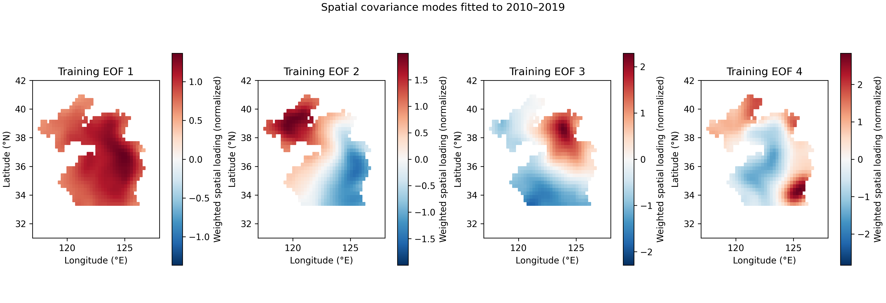
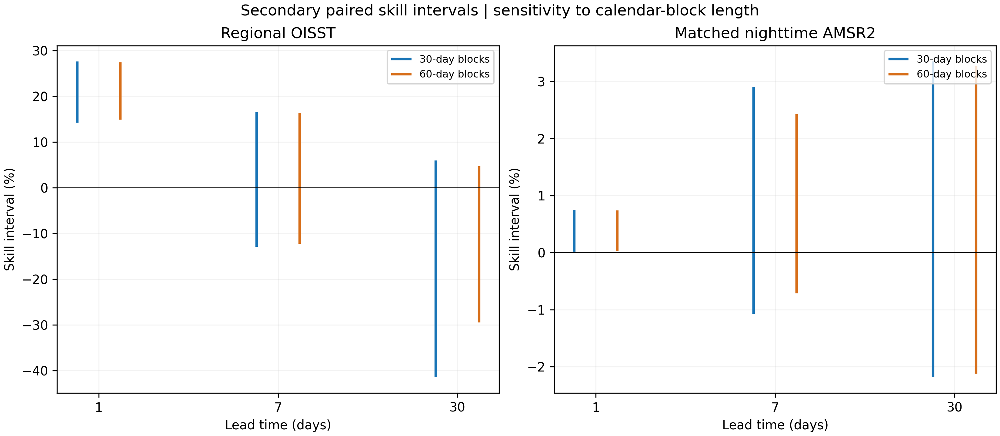
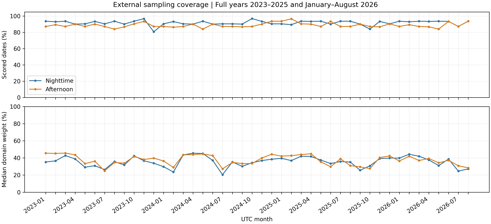
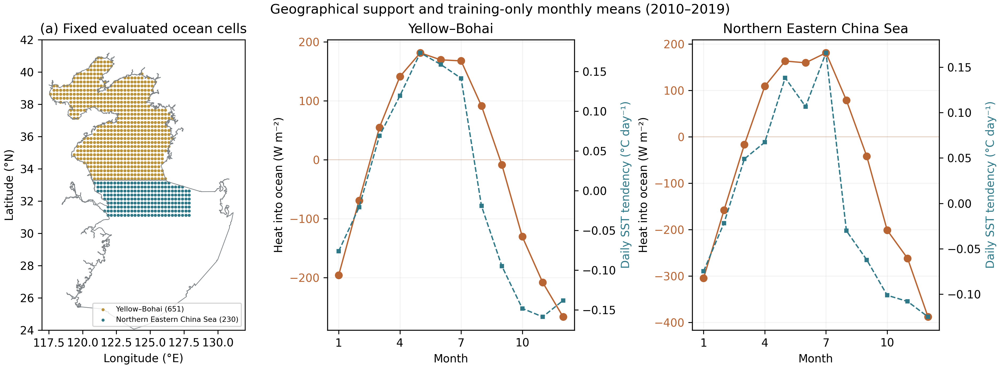
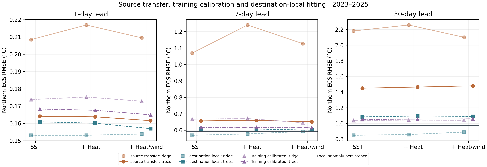
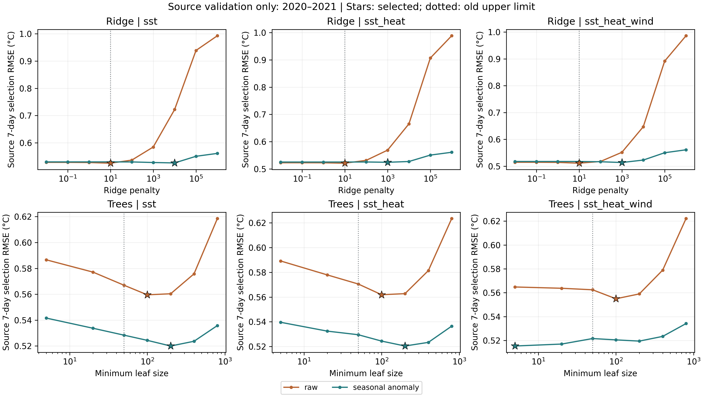
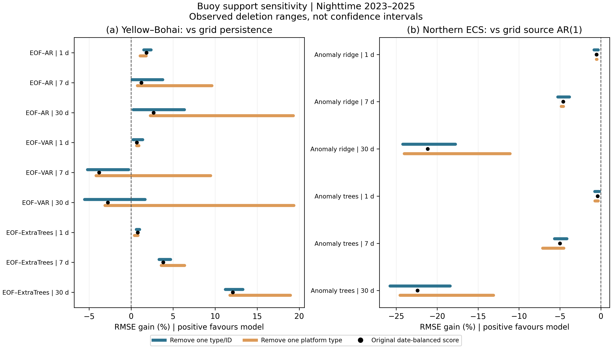

# Supplementary information

## Spatial aggregation and observation-source dependence of short-range SST forecast skill in the Yellow–Bohai Sea

### S1. Evidence chronology and frozen records

The original regional exploration uses 2010–2025 OISST and several chronological test folds. Its latest model uses 2010–2019 for fitting, 2020–2021 for selection, 2022 for symmetric interval calibration and 2023–2025 for historical testing. The temporal protocol was committed before acquiring January–August 2026 OISST targets. Its SHA-256 is 8a11e5b9b56845936cbd72495a2f066bd2d5ae2a2a9044bc18282169ce684aa4; protocol commit d0f6f17d84054df852c96640fe8ca5a9033c8fcf records the model choices.

The independent-instrument protocol was frozen after inspection of the OISST 2026 scores, but before reading the AMSR2 target values. Its SHA-256 is ecc8c46b5f2653dc2e4f3e636c9206a2460bbe2c5dd15123f82ad51cdaba2f03; protocol commit a3deb64aba90017d59b47ac1c9404f0efbe41ad7 records that design. The linked forecast, history and spatial-mask hashes are preserved in the protocol. The 2026 origin history was assembled from the already locked regional targets, requiring identical values where target records repeat; individual forecasts still access only their origin and earlier observations.

The spatial and diagnostic extension was designed on 9 October 2026 after all original outcomes had been viewed. Its local design record is not public preregistration and is not an untouched external test. Coefficients, EOFs and mode autoregressions are fitted only to the training period; candidate selection uses only the selection period. This is an important computational restriction, but the scientific decision to add these models and diagnostics remains retrospective. No frozen primary model, threshold, external bias or calibration radius was altered.

### S2. Source acquisition and decoding

Two hundred monthly NOAA OISST subsets cover the 6,087-date record and the 44×44 acquired grid. The fixed polygon mask comprises 651 cells. Each subset has its provider URL, acquisition metadata and SHA-256 checksum. The original regional means use single-precision xarray cosine weights and reductions, followed by CSV rounding; new spatial diagnostics use double-precision weights and losses. Their maximum regional-mean difference is approximately 1.23×10⁻⁵°C, within a documented 2×10⁻⁵°C precision check. Frozen forecasts and primary metrics retain their original arithmetic. New external RMSE replication must agree within 10⁻⁵°C and use exactly the original scoring-date counts.

RSS files follow the daily version 8.2 provider naming convention. Remote byte-range acquisition preserves strong entity tags and chunk hashes before writing the cropped subset. Arrays contain separate ascending and descending SST, UTC measurement times and the land, coast, sea-ice and no-observation masks. Per-subset checksums and all provider URLs are retained in the independent provenance record. Native cell centres match the OISST centres; no external spatial interpolation or gap filling is performed.

A complete 5 February 2026 source file was also downloaded and decoded with NetCDF automatic scale/mask handling, independently of the HDF5 byte-range subset path. SST, times and the four quality masks match exactly. The complete-file SHA-256 is 6eb061870361ee819ab39597debde4db61aa412381f6dc3c94c892378c0a858f. The audit tests extraction integrity; it is not an independent calibration or buoy comparison. Its date was selected after inspecting product differences, and no scoring rule changed as a result.

### S3. Spatial candidate calculation

The training seasonal field is an ordinary least-squares regression on an intercept and three sine/cosine pairs, with optional linear trend. Let a(d) be its residual field, W the diagonal normalized cosine-weight matrix and U the eigenvectors of the training covariance of W¹ᐟ²a. The weighted EOF scores are z(d)=UᵀW¹ᐟ²a(d). Retained score histories are fitted with autoregressions using an intercept. The reconstruction operator is B=W⁻¹ᐟ²U. Only retained modes are propagated; unresolved origin anomalies persist according to equation (2) in the main text.

Each EOF column is signed so that its largest absolute loading is positive. This convention does not identify a mechanism or affect forecasts. Rank, order and trend are selected by minimum seven-day mean daily complete-grid squared error in 2020–2021; ties favour lower rank, lower order and no trend. Unstable candidates are excluded before scoring. The selected rank is {{spatial_rank}}, order is {{spatial_order}}, trend inclusion is {{spatial_trend}}, and retained training variance is {{spatial_variance_percent}}%. All selection scores appear below; 2026 performance is not used for selection.

**Table S1. Training-only candidate selection.** RMSE is in °C. The table includes every eligible stationary candidate.

{{selection_table}}

**Figure S1.** The first available retained modes are shown, up to four panels. Loadings are normalized for display, with sign conventions described above. They describe covariance structure on the fitted field, not independently established circulation or heat-flux mechanisms.

### S4. Calendar-block inference

The original paired daily bootstrap uses 1,000 replicates and 30- and 60-day blocks. The new secondary analysis uses 1,999 circular-block replicates, random seed 20261009, and retains unscored calendar dates as gaps. Every replicate draws one set of dates for both model and baseline. The difference series is centred at its observed mean to generate a null distribution for equal expected squared losses. The two-sided p value includes a one-count correction. Percentile intervals are calculated from paired RMSE skill and squared-loss advantage draws. At least 100 valid draws are required.

Separate six-member families are formed for each block length: regional OISST at three horizons and nighttime AMSR2 at three horizons. Holm adjustment uses the ordered p values with monotonically increasing adjusted values. Its family-wise interpretation depends on the validity of the individual p values; approximate stationary-loss assumptions and the short, seasonally evolving record remain limitations. Afternoon results and retrospective spatial controls are not added to this family and are not assigned adjusted confirmatory claims.

**Table S2. Secondary inference for the original frozen comparisons.** Skills and their bounds are fractions. These intervals use the new replicate count; the original published intervals remain the primary record.

{{inference_table}}

**Figure S2.** Secondary 95% skill intervals using thirty- and sixty-day blocks. The two panels correspond to the separate verification targets within the six-comparison family. The figure does not establish validity of stationary-block inference for a seasonally varying eight-month sample.

### S5. Seasonal scores and calibrated interval quality

Seasons use calendar months: DJF (December–February), MAM (March–May), JJA (June–August) and SON (September–November). The historical evaluation has three full annual cycles; the 2026 evaluation has January–August only. No 2026 SON values are filled. The 2026 DJF subset lacks December and should not be directly interpreted as the same seasonal exposure as historical DJF. The number of scored dates accompanies each summary.

**Table S3. Seasonal regional errors for the frozen selected projection.** RMSE and bias are in °C. Double-precision spatial projection arithmetic can differ slightly from the original region-only calculation.

{{seasonal_table}}

For interval limits l and u, observed SST y and nominal miscoverage α=0.05, the interval score is (u−l)+(2/α)(l−y) when y<l, or (u−l)+(2/α)(y−u) when y>u, and equals the width otherwise. We report coverage, mean width and mean score for the already frozen radii, without recalibration. The score is proper for the target quantiles, but empirical performance under serial dependence and drift must still be assessed.

**Table S4. 2026 regional interval diagnostics by model, horizon and season.** Coverage is a fraction; width and interval score are in °C. This table includes baselines and is distinct from external gridded verification.

{{interval_table}}

### S6. Surface memory and sampling diagnostics

Regional residuals are calculated on training data after subtracting an estimated harmonic cycle and trend. At each lag, Pearson correlations use only pairs whose endpoints fall within the same named season. The accompanying CSV also reports lag-one linear coefficients and AR(1) half-lives where 0<φ<1. These describe the sample; they do not establish physical relaxation times. Inferring seasonal reemergence requires subsurface and heat-budget evidence.

**Table S5. Same-season lagged associations in the training regional series.** No 2026 observations enter these values.

{{memory_table}}

Grid-to-land distance is the minimum spherical distance from an ocean cell centre to a cell missing OISST on 1 January 2010 within the 44×44 acquisition box. Bins are [0,50), [50,100) and [100,10000) km. The proxy is bounded by this box and does not represent the nearest high-resolution coastline. On each scored date, discrepancies are first weighted within each available bin and then averaged equally over its dates. Different bins and seasons can have different cell–date compositions, so their differences are descriptive rather than controlled estimates of distance effects.

**Table S6. Seasonal product differences by land-distance proxy.** RMS difference and bias (OISST minus AMSR2) are in °C. Date counts, cell–date counts and pass labels specify the available support.

{{distance_table}}

### S7. Complete spatial comparison results

**Table S7. All spatial evaluation metrics.** Both skill columns are fractions. Frozen anomaly projection and grid-specific anomaly persistence are different baselines. Each within-target comparison uses identical masks and dates; across-target differences may reflect spatial support as well as the source. Raw grid persistence is retained as a secondary reference.

{{all_metrics_table}}

### S8. Reproduction and integrity checks

**Table S8. Descriptive paired block intervals for the retrospective EOF–AR control.** Each skill interval is relative to the named baseline and uses a common scoring support. These unadjusted intervals are exploratory; no p-value claim is added to the frozen six-comparison family.

{{spatial_intervals_table}}

Reproduction proceeds through the original historical research, the frozen OISST validation, the frozen AMSR2 validation, and then the publication extension. The extension entry point is `python -m src.publication`, with `configs/publication.json` defining the explicit candidate grid, temporal boundaries and scoring rules. Frozen protocol hashes are checked on input. NOAA subset and AMSR2 subset hashes are checked before scoring. The fixed field has consecutive daily dates, matching coordinates and finite ocean values. No candidate fitting routine reads selection or evaluation observations to estimate parameters.

Daily CSVs retain errors, masks/counts and all loss components; aggregate tables average those daily quantities. Both exact identities are checked on every matched scoring date with an absolute 10⁻¹⁰°C² threshold. The maximum observed residual in the loss decomposition is {{identity_tolerance}}°C². Altering future values in dedicated tests cannot change training parameters or an origin-restricted forecast. Further tests cover paired support, multiplicity adjustment, cancellation of discrepancy loss by a negative interaction, and interval-score penalties.

Tables in the manuscript and supplement are generated from the analysis outputs. Figures are supplied as 300 dpi PNG and scalable SVG files with checksums. Protocol records include software and acquisition hashes, exact model parameters, seeds and analysis scope. An immutable archived release with a DOI should accompany final submission. Author identities, affiliations, funding, conflicts and contributor roles must also be confirmed before submission.
### S9. Three-year acquisition lock and stronger controls

The three-year forecast lock (`paper/confirmation/frozen_protocol.json`, SHA-256 `cf6a462d4d55ecd80915925cea8bba313680f11402a708d9764bc8715a761502`) precedes the new AMSR2 acquisition. Public commit `6edc533f2cd5f7d0d6f61a0b441f6610cd54ebed` records the design and hashes at 03:34:52 UTC on 10 October 2026. The pre-existing spatial basis, regional forecasts and all seven new forecast arrays were fixed at this stage. All 1,096 external dates were obtained without source absences; insufficient valid cells still exclude individual dates from scoring. Original 2026 selected-forecast scores are reproduced to the documented 10⁻⁵°C tolerance.

New control selection is restricted to the previously specified training and selection boundaries. Ridge VAR uses standardized lagged modal features, an unpenalized intercept and an L2 penalty scaled by the number of training pairs. The companion spectral radius must remain below one. Its recursively propagated retained scores enter the same spatial increment reconstruction as EOF–AR. The tree control standardizes each retained modal increment by its training standard deviation before joint fitting, so high-variance modes do not automatically dominate its split loss. Each horizon has separate training targets, while leaf size and feature fraction are selected once at seven days. Elapsed time and calendar harmonics are deterministic target features; all SST features are origin restricted. Horizon overlap and rolling origin updates do not permit reading intermediate future observations.

**Table S9. Every stronger-control candidate.** Selection RMSE is in °C. Candidate settings and all fitted coefficients remain in the machine-readable results.

{{confirmation_selection_table}}

**Table S10. New nighttime nine-comparison family, both block choices.** Pointwise skill bounds are percentages and are not family-wise confidence bounds. Holm-adjusted p values are listed independently. The seed, number of replicates, primary pass and baseline were fixed before acquisition; this family is separate from Table S2.

{{confirmation_inference_table}}

**Figure S3.** Annual skill is descriptive and compares identical dates/cells against grid-specific anomaly persistence. A pooled improvement can coexist with a negative year. No annual significance claim or retrospective exclusion of an unfavourable year is made.

**Figure S4.** Paired pointwise 95% intervals from 30- and 60-day calendar blocks. Multiplicity-adjusted tests appear in Table S10; a positive interval need not imply adjusted significance.

**Figure S5.** All acquired dates enter the denominator for the fraction of dates meeting the minimum-20-cell gate. Domain weight fractions use the fixed cosine-latitude mask. The new three full years and the separate January–August 2026 window are shown without imputing missing observations.

**Table S11. Change in thirty-day squared-loss advantage between matched OISST and AMSR2, 2023–2025.** The baseline is grid-specific anomaly persistence. All entries are °C² and use identical date/cell support. The difference between external and analysis advantage equals the signed discrepancy perturbation; positive product discrepancy alone does not determine ranking.

{{confirmation_transfer_table}}

### S10. In situ matching, weighting and dependence

The iQuam protocol (`paper/insitu/frozen_protocol.json`, SHA-256 `4eac347075875db867689e80369b43b04d289efcf0dc7d6cff85966dceb4ddcf`) was publicly committed at 03:55:21 UTC on 10 October 2026 in `16fa9b784692c9bf2eacdf5513433865a3e602db`, before reading iQuam SST values. Only a variable/attribute inventory and official source filenames had been inspected. For each month, the highest file-version suffix visible at that time was fixed in the protocol; subsequent retrieval does not select a replacement version after seeing temperatures.

Accepted point matches have quality level 5, finite SST from −2 to 35°C, buoy platform type 2/3/4/6/8, a nonempty identifier and a thermometric observation (provider `sst_flags` bit 0 equals zero). Bit 1 distinguishes nighttime and daytime. Time is measured in seconds since 1 January 1981 00:00:00 UTC; observations must fall within both the recorded source month and the evaluation window. The nearest fixed-cell centre, calculated on a sphere, must be within 20 km. This point-to-grid rule does not locate an exact coastline or match the observation time and depth to those of the daily analysis. No interpolation, depth correction, diurnal adjustment or SST bias correction is fitted.

Let eₚₖd be a collocated error for record k from platform identity p on date d, with platform type included in the identity. Daily loss is L(d)=P(d)⁻¹Σₚ[nₚd⁻¹Σₖeₚₖd²], where P(d) counts sampled platforms and nₚd counts a platform's records that date. RMSE is the square root of the equally weighted date mean of L(d). Absolute and signed errors follow the same nested weighting. This retains within-platform variation in squared errors; squaring the platform-mean error would lose it. Repeated hourly records cannot dominate other platforms or count as independent replicates. Platform support and every annual result are retained in CSV files.

{{insitu_results_text}}

**Figure S6.** Displayed points are the unique coordinates of accepted nighttime/daytime observations, with fixed ocean-cell centres for context. Identical coordinates are plotted once; all temporal records are retained for scoring. Map density does not measure effective independent sample size. The scoring scheme balances platforms within dates and dates within the sample, not geographical area.

**Table S12. Annual nighttime buoy scores for the nonlinear spatial control and persistence.** Values are descriptive; shared quality-control references and possible OISST assimilation overlap preclude an independent-truth interpretation.

{{insitu_annual_table}}

### S11. Additional reproduction and integrity

The original frozen protocols and primary tables are preserved. With historical NOAA inputs and the original frozen records in place, `python -m src.confirmation prepare` verifies and retains existing locked forecast bytes; it refuses to overwrite an existing lock. `python -m src.confirmation acquire --workers 4` obtains or verifies every 2023–2025 AMSR2 date. `python -m src.confirmation_evaluation` requires all dates to be acquired or explicitly recorded absent and scores the frozen arrays. `python -m src.insitu acquire --workers 3` verifies or acquires every fixed iQuam source month; `python -m src.insitu evaluate` uses the same frozen arrays. `python -m src.publication_delivery` assembles the integrated manuscript and reviewed aggregates without fitting or selecting models again.

For reconstruction from upstream caches, `python -m src.confirmation_rebuild --output-dir data/processed/confirmation_rebuild --install-exact` repeats the original fixed fitting/selection calculation in a new directory and installs missing archived outputs only when every frozen SHA-256 matches. It cannot overwrite a conflicting archive. On 15 October 2026, in the recorded software/platform environment, the independent rerun reproduced all four output files byte for byte: candidate selection, benchmark parameters, serialized tree models and the complete 1,339-date forecast cube. This is a post-outcome computational replication, not a new prospective freeze; the original forecasts and outcomes remain unchanged. The reconstruction audit accompanies the reviewed results.

HTTP range responses require exact byte counts, explicit range bounds and a stable strong ETag. Interrupted bodies are retried and are never cached as valid bytes. An extraction optimization decodes only requested variable-length platform identifiers; comparison with the original method on the same May 2024 source gives identical values for all ten stored arrays and the same subset SHA-256. The audit records both software hashes. Newer official files omit old root version/date attributes; compatibility checks instead require the already frozen versioned filename, provider title/institution, identical units and actual point UTC-month filtering. These transport/format changes do not alter the frozen geographic subset, source selection or matching rules. Source URL/ETag, verified byte-range hashes, acquisition timestamps, subset hashes and source metadata accompany every local input. Freeze chronology, score replication and exact loss identities are checked separately from the geophysical dependencies of the observing products.

### S12. Retrospective physical-information and geographical-transfer controls

The local design record in `paper/process_transfer/design_record.json` specifies the configuration, acquisition-based scope amendments and software hashes. Earlier OISST and external forecast scores were known, so it is not a prospective public freeze. The source and destination evaluations use fixed, non-overlapping ocean centres. The destination comprises only the northern Eastern China Sea intersection with the original acquisition box; it was not selected by forecast error. Figure S7 shows both the evaluated cells and the unsampled part of the destination polygon. The original frozen forecasts and protocols retain their checksums.

All eight NCEP/NCAR R1 fields use the official daily-averages surface-Gaussian archive. Original response hashes and cropped-file hashes are retained for 128 variable/year files. The regional Gaussian weights are sums of the original SST ocean weights assigned by spherical nearest centre. Coarse cells may contain land and do not resolve the coastline. Net heat input is constructed from four separately directed radiation fields to avoid ambiguity in net-radiation sign conventions. Upward turbulent fluxes are subtracted. Provider values are retained without clipping small negative directed radiation artifacts. The feature is a reanalysis diagnostic, not an observed ocean heat budget. Magnitude is computed after daily regional u/v averaging and must not be interpreted as the average scalar speed, stress or resolved mixing energy.

For a target d and lead h, SST features stop at d−h and the 1/7/30-day forcing windows stop at d−h−1. Target calendar harmonics and the elapsed-time feature are known at origin. Source and destination features share the same ordered definitions. Source training means and standard deviations are retained unchanged for transfer. Labels used to estimate a direct h-day increment end by 2019; no increment ending in selection or evaluation enters fitting. Separate source 2020–2021 seven-day selection is applied to each family and feature group, after which all three horizons use the source-selected hyperparameter. In this run every group selects the largest enumerated ridge penalty (10) and minimum tree leaf (50); the inference is conditional on this finite grid and does not exclude different behaviour under stronger regularization or another representation. Destination-local models are not independently tuned. The 2022 interval-calibration year from the original study is not reused to calibrate these new point predictions.

The two new groups add either three heat features or twelve heat/wind features to the 17-feature SST design. Ridge uses a fitted intercept; ExtraTrees uses 200 estimators, all features, fixed seed 20261016 and minimum leaf sizes selected from 5/20/50. Missing values are rejected without interpolation. The original regional forecasts and locked spatial ExtraTrees model are distinct from these new direct regional models and are not replaced by them.

**Table S13. All twelve source-region forcing contrasts.** Gains are percentages relative to the same family fitted with SST/calendar only. Sixty-day block intervals are pointwise; Holm p values adjust over all 36 source/local/transfer contrasts. Both block lengths, all 36 comparisons and every annual and seasonal score are archived in CSV files. Positive intervals alone do not establish multiplicity-adjusted support or remove hindsight.

{{process_forcing_table}}

**Figure S7.** Panel (a) shows only the evaluated fixed SST ocean-cell centres in colour; grey outlines are the official IHO sea-area polygons, including the unscored Eastern China Sea extent. The other panels show monthly averages of reanalysis net heat input (brown) and daily SST tendency (blue), estimated from 2010–2019 alone. Separate axes have different units and the curves do not constitute a heat-budget closure, regression estimate or causal test. No mixed-layer depth or advection is observed.

**Table S14. Every SST-only geographical-transfer score.** January–August 2026 and the three complete years remain separate. Direct transfer uses the identical source fit/scaler; destination-local references use destination training observations with source-selected hyperparameters. RMSE is °C. Negative skill values are retained.

{{process_transfer_full_table}}

**Figure S8.** All groups and both families are retained at all three leads, including the additional training-calibrated reference added after inspecting the raw transfer failures. Lower RMSE is better. The horizontal benchmark uses destination-local training climatology, while direct transfer uses no destination-fitted coefficients. These are descriptive OISST comparisons on an adjacent shelf subregion, not independent-instrument or full-basin geographical validation.

#### Additional matched-satellite diagnostic

The source-region cell forecast adds the new predicted regional increment to the origin OISST field. All eighteen family/group/horizon forecasts are evaluated on the same nighttime dates using the unchanged AMSR2 flags, cosine-latitude weights and 20-cell minimum. This projection check was added after the local design record and is descriptive. It introduces no estimated spatial pattern, SST bias correction, model selection or p value. Matched OISST and AMSR2 aggregate and annual scores are archived with the daily series.

{{process_external_text}}

#### Reproduction and computational safeguards

With the original OISST cache in place, run `python -m src.process_transfer prepare`, `python -m src.process_transfer acquire --workers 3`, `python -m src.process_transfer evaluate`, `python -m src.process_external`, `python -m src.process_alignment` and `python -m src.process_transfer deliver`. Boundary geometry is acquired directly from Marine Regions, validated by identifier/name/bounds/axis order and retained locally. Provider geometry is not redistributed. The forcing downloader verifies the R1 product identifier, field units, exact daily calendar and finite cropped values. Raw response and subset hashes are kept separately. No 2026 forcing window is silently shortened: that entire new forcing comparison is excluded because the chosen product ceased production in March. No replacement reanalysis was selected after examining scores.

Future-perturbation tests confirm that changing SST after the origin or weather on/after the origin cannot change an individual feature row; changing post-training labels cannot change training scaling or coefficients; changing post-selection outcomes cannot change the source hyperparameter; prediction on destination features cannot mutate the source scaler or coefficients. Original locked-file hashes are checked before and after the new experiment. These checks establish the stated computational information restrictions, not observational independence or measured operational latency.

#### Post-outcome calibration reference: explicit destination-training information

After the unchanged-source failures had been inspected, an additional descriptive location/scale reference was added (`python -m src.process_alignment`). Source regression/tree coefficients and source-selected hyperparameters are retained. For destination features Xd, z = (Xd−mean_d)/sd_d uses only destination 2010–2019 feature statistics. If the source predictor produces an increment u(z), the calibrated destination increment is mean_delta_d + sd_delta_d [u(z)−mean_delta_s]/sd_delta_s. Source and destination increment moments use only targets ending by 2019 and the complete training feature rows. No local regression or tree coefficients are used. The destination scaler is retrieved from the training statistics already stored with the local-reference model, independently of its fitted predictor.

This reference uses destination training histories to estimate calibration parameters. It is neither unchanged-scaler transfer nor a destination-data-free forecast. All feature groups, families, leads and annual scores are retained; no extra tuning, p value or selection is attached. The joint feature/increment calibration cannot separate individual causes of geographical shift, and its addition after seeing raw failures is recorded rather than treated as preregistered evidence. Tests verify that future labels cannot alter its increment moments, that changing local regression coefficients cannot alter its forecasts, and that an affine copy of a source series yields the corresponding affine-calibrated forecast.

**Table S15. SST-only transfer with destination-training calibration.** All numbers are °C. Raw transfer and local-fit references reproduce Table S14; the extra calibrated column uses destination training location/scale. Both periods, families and all leads are retained.

{{process_alignment_table}}

### S13. Expanded grids, climatology-assisted transfer and simple memory controls

The local design and benchmark record in `paper/anomaly_transfer/` were prepared after the raw-transfer failures and upper-edge selections were known; neither is a public prospective lock. This phase preserves the original forecasts, protocols, process-transfer results and statistical families. It retains both representations, all three feature groups and all source-selected families and leads, without a destination hyperparameter search. Forcing-group evaluation ends in 2025; January–August 2026 uses SST only.

{{anomaly_methods_text}}

Training cycles are evaluated at future calendar dates using fixed coefficients, not refitted to evaluation outcomes. Origin and lagged SST values are locally observed inputs. Weather windows end at least one calendar day before the origin. Feature construction is verified against perturbations beyond these cutoffs. Local-reference fits use the source-selected hyperparameters, without destination-specific optimization. All twelve source choices and every validation candidate score are archived, including ridge effective degrees of freedom and median tree leaf counts.

**Table S16. All source-selected configurations.** Selection RMSE is °C for seven-day source forecasts in 2020–2021. A lower-edge heat/wind anomaly-tree choice remains, preventing a claim that every candidate-boundary issue is resolved. Raw ridge choices become interior without changing value.

{{anomaly_selection_table}}

**Figure S9.** Stars mark each representation/family/group choice based only on pooled 2020–2021 RMSE. Dotted lines show the former upper grid value. Both axes use their plotted units; hyperparameter axes are logarithmic. Curves do not show destination or test outcomes. No uncertainty or repeated-validation stability is inferred from a single pooled selection.

**Table S17. All SST-only destination transfer comparisons.** RMSE is °C. Gain and pointwise 95% paired 60-day block intervals compare the anomaly model with destination-local AR(1), not source AR(1), raw transfer or climatology. They are unadjusted descriptive intervals, not simultaneous coverage or a new confirmatory test. Both 30/60-day choices are archived in `decay_reference_intervals.csv`. Three full years have 1,096 dates; January–August 2026 has 243.

{{anomaly_transfer_full_table}}

Climatology-only destination RMSE is 0.9410°C in 2023–2025 and 0.7356°C in January–August 2026 at every lead, since it ignores the forecast origin. Full annual and seasonal outcomes, destination-local fits, all forcing groups, baseline metrics and satellite projections accompany the aggregate CSVs. At thirty days the source AR(1) transfer is slightly better than either SST-only complex anomaly model over the three full years; this point-estimate comparison is distinct from the local-AR(1) intervals tabulated above. No interval against source AR(1) or climatology is inferred from an interval against another reference.

#### Satellite common-support reference reconstruction

Every regional model is projected as the observed origin OISST spatial field plus a uniform predicted regional increment. For a given date/lead/target on the same normalized visible-cell weights, squared loss of an increment delta has the exact form A + 2 B delta + delta² and bias B + delta. Recovering A and B from an already audited regional projection allows identical-support scoring of fixed climatology and AR(1) projections. Before scoring them, this quadratic is checked against every directly computed new-model daily loss (maximum discrepancy below 1e-10°C²). This is algebraic reuse of identical observations, not a new measurement or independently estimated truth. `external_reference_audit.json` records the actual discrepancy and input hashes. `external_benchmark_metrics.csv` retains both matched OISST and AMSR2, both periods and all leads; `external_decay_intervals.csv` compares new source models to projected source-local AR(1) with descriptive 30/60-day pointwise intervals.

#### Reconstruction and completeness

With prior caches intact, run `python -m src.anomaly_transfer prepare`, `python -m src.anomaly_transfer evaluate`, `python -m src.anomaly_transfer external`, `python -m src.anomaly_benchmarks`, `python -m src.anomaly_reference_external`, `python -m src.anomaly_transfer deliver` and `python -m src.publication_delivery`. No new external values are required. The design verifies aggregated input hashes; evaluation reproduces every original narrow-grid validation score and preserves the prior frozen files and complete process-transfer outputs. Numerical reconstruction checks every scientific CSV to 1e-10 tolerance; tree parallelism can change floating-point sums and serialized model bytes. The record does not claim cross-platform byte identity. Local data packages include full predictions, daily losses and the model archive; reviewed repository tables omit large daily files. New pointwise intervals are explicitly separate from the old six-, nine- and thirty-six-comparison families.

### S14. Destination satellite and buoy verification

The publicly accessible [pre-scoring commit](https://github.com/Joao-Ray/yellow-sea-sst-stochastic-modeling/commit/0d9d318fece43baa067ae853e598e7681ce10767) contains the protocol, software, input hashes, every forecast-array fingerprint and exact source versions. The lock was remotely verified on 21 October 2026 before destination scoring began. Source files had already been acquired and earlier source-region/destination-OISST results were known. This chronology supports a fixed conditional geographical comparison, with no claim that all design or raw data were previously unviewed. In particular, the earlier process-transfer audit's acquisition wording is corrected: the rectangular satellite cache already contained destination cells, whose destination scores had not been produced. The historical audit is retained.

All thirteen methods and three leads use the same source-selected regional predictions or fixed references. Projected source AR(1), local AR(1), regional climatology and anomaly persistence retain origin spatial offsets. Separate grid references fit three harmonic orders plus a linear trend on each destination cell's 2010–2019 values. Grid source/local AR(1) uses the previously estimated source/destination **regional** coefficient; this does not fit 230 separate decay parameters. Grid climatology ignores origin anomalies; grid anomaly persistence does not damp them. Grid climatology is distinct from projecting the regional climatology while preserving origin spatial offsets.

**Table S18. Complete locked primary family.** Two anomaly models × three leads × three references. Positive gain favours the anomaly model. Intervals are unadjusted pointwise 95% paired intervals; both p columns are two-sided and Holm adjusted within all eighteen contrasts at their named block length. A small adjusted p with negative gain supports deterioration. Nothing is added to or removed from the older six-, nine- or thirty-six-comparison families. The use of stationary circular blocks and prior outcome-dependent design limits interpretation.

{{destination_inference_table}}

**Table S19. Every nighttime buoy method, 2023–2025.** RMSE is °C on 1,051 equally weighted dates after balancing platform type/ID within each date. These values are descriptive, with no new buoy significance test. Record counts, platform support, annual/seasonal outcomes and daytime/matched-OISST metrics accompany the CSVs.

{{destination_buoy_table}}

**Figure S10.** Satellite bars show the number of dates meeting the fixed twenty-cell gate; the line shows median visible destination weight across all nights in each month, including unscored nights. Buoy bars count dates after quality and source-proximity exclusions. Satellite coverage includes January–August 2026; the version-fixed buoy collection ends in 2025. All three primary satellite years exceed the 120-date gate, and all buoy years exceed the sixty-date gate. Passing a date-count gate does not establish full spatial coverage or missing-at-random sampling.

#### Point matching and prior-support exclusion

Best-quality thermometric iQuam buoy records use the same version, temperature bounds, platform types, day/night flags and UTC calendar as the source-region analysis. Each record must be within 20 km of a destination centre and **more than** 20 km from every source centre. This removes locations eligible for the earlier source match, including boundary cases, without using temperature outcomes. Repeated observations contribute to their platform-day squared, absolute and signed losses; platforms are then weighted equally within dates, and dates equally over the period. A platform may operate in different regions or years, so the geographical exclusion does not make platforms or quality-control references statistically independent.

#### Independent implementation audit

`python -m src.destination_audit` reconstructs masks directly from original satellite caches, verifies every model's daily weighted loss, and independently matches all buoy records using double-precision unit-sphere KD-tree candidates with spherical reranking at the frozen coordinate precision, instead of the production all-pairs search. It compares complete record multisets and nearest-cell assignments. The original stored float32 cell-angle conversion and stable tie order are preserved: at near bisectors, a fully double-precision alternative can select an adjacent cell, so changing precision would change the locked matching rule. Regression tests cover these cases. Inverse platform-day and daily-platform weights with independent accumulation reproduce hierarchical buoy scoring. Every satellite/buoy daily loss is required to agree within 1e-10, and all frozen arrays and earlier outputs retain their hashes. This verifies scientific arithmetic and extraction; it does not make the underlying observation sources or acquisitions independent.

Reproduce with `python -m src.destination_validation prepare`, public-lock verification, `python -m src.destination_validation evaluate`, `python -m src.destination_audit`, `python -m src.destination_validation deliver`, and `python -m src.publication_delivery`. The original public protocol remains fixed. Archive hashes identify the fitted grid coefficients, source manifests, complete locked projections, daily losses and point matches; large arrays and daily point records are distributed in the local data package. The official iQuam notice about discontinued human monitoring remains applicable, and quality-control reference and potential OISST input overlap are retained as evidence boundaries.

### S15. Retrospective buoy platform-support sensitivity

Date balancing prevents frequent records from dominating a platform-day, but platforms observed over many days can still account for a large share of period loss. We designed this sensitivity after the instrument results were known. It uses accepted point matches and locked forecasts from both regions, without changing quality thresholds or models or adding inferential tests. A removal unit is the composite platform type/ID across the whole 2023–2025 record; it is not proof of a distinct independent physical device. All seven source and thirteen destination methods, three leads, both passes and both buoy and same-point OISST targets are retained. Source skill uses grid anomaly persistence; destination outputs retain grid source AR(1), projected source AR(1) and grid climatology contrasts. Display tables use the grid source AR(1) reference for destination models.

For each model and record, squared, absolute and signed error is averaged within a platform-day. Remaining platforms receive equal weight within each surviving UTC date; dates then receive equal weight. We remove every platform combination and every observed platform type separately, retaining all removals rather than selecting favourable cases. If removal eliminates a date, that date is omitted without imputation. The output also scores the **original full set of platforms on precisely those same retained dates** (`full_on_retained_dates_*`), so date-support changes can be distinguished from removing a platform within shared dates. The two models in each skill contrast always share exactly the same removal and retained-date support. An alternative summary assigns equal total period weight to each platform, and equal dates within each platform; it changes the estimand and is not substituted for the original date-balanced score.

{{buoy_robustness_detail_text}}

**Table S20. All leads for the principal buoy comparisons.** Gain is 100 × (1 − model RMSE / reference RMSE). Positive values favour the model. Removal ranges describe the minimum and maximum over actual exclusions, without resampling; they are neither confidence intervals nor jackknife standard errors. Equal-period-platform gain is a different weighting estimand. Negative cases and both anomaly families are retained; the complete all-model, daytime and matched-OISST outcomes accompany the CSVs.

{{buoy_robustness_table}}

**Table S21. Platform contribution to the original date-balanced score.** Each platform's weight sums 1/(number of active platforms) over its active dates and divides by all scoring dates. Thus platform weights sum to one in each region/pass. Their inverse squared-weight sum describes concentration only: it is not the number of independent observations, an effective inferential sample size, or a correction for time dependence. A single-platform date is counted once; raw record fractions are preserved separately in `platform_weights.csv`.

{{buoy_robustness_support_table}}

Removing type 4, which provides most persistent matches, leaves only 231 source and 288 destination nighttime dates, versus 1,036 and 1,051 originally. These subsets have substantially different temporal and geographical support. The whole-type results cannot establish performance for the full period, all seasons or the basin as a whole. The source thirty-day advantage and destination deterioration retain their signs under these exclusions, but no excluded sample becomes statistically independent of the original records or analysis-based QC. Changes in observing coverage and the iQuam monitoring notice remain relevant.

**Figure S11.** Blue segments span all single type/ID exclusions; orange segments span all whole-type exclusions. Black points show original date-balanced gain. Panel (a) includes all three stronger source spatial controls; panel (b) includes both destination anomaly-transfer families. Axes use different ranges. Endpoints reflect changed observation support and platform weighting, not sampling uncertainty; the complete scoring data include all retained-date references.

#### Arithmetic, preservation and reproduction

Run `python -m src.buoy_robustness` after the original source and destination evaluations, then `python -m src.publication_delivery`. Before generating sensitivity results, the new program reproduces every original buoy daily squared, absolute and signed loss: 87,150 source rows and 164,190 destination rows, with zero recorded numerical difference in the recorded environment. These 251,340 rows are model/lead/target scores, not independent measurements. The audit records all inputs, software/runtime versions and 268 prior-stage file hashes; all are unchanged before and after scoring. Full metrics, 16,734 removal contrasts, annual outcomes, platform weights and complete summary tables are archived with checksums. The sensitivity neither changes the earlier public protocols nor reinterprets their statistical families.
